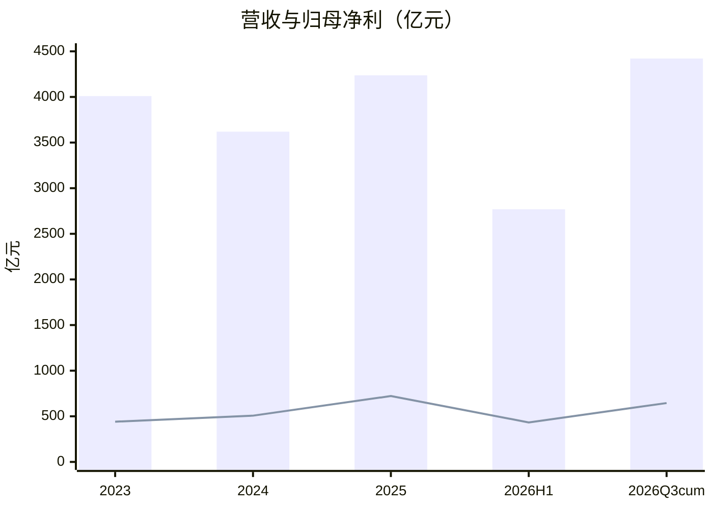

# 宁德时代（300750）投研总览

> 财务时点 2026-09-30；行情与催化检索时点 2026-10-22。框架 **value-leader-research 2.2.0**。不构成投资建议。

## 一句话判断

量仍在、利在让：Q3 毛利率 20.7% 与 CFO −24% 改写利润率叙事；现价 220 贴中性隐含带下沿（**223–260，中枢≈242**），贵贱取决于税负传导与毛利率能否止跌。

## 关键指标

| 指标 | 数值 | 来源 |
|------|------|------|
| 现价 / 市值 | 220.41 / 10199 亿 | 腾讯 10-22 |
| PE TTM / PB | 11.63 / 2.64 | 同上 |
| 五年 PE·PB 分位 | ~0.08% / ~0.08% | baostock |
| PB-ROE | **9.04%** | 五年均 ROE 23.85% / PB 2.64 |
| 2025 营收/归母 | 4237 / 722 亿 | 新浪/年报 |
| 2026 前三季度 | 4421（+56%）/ 645（+32%） | 新浪 |
| 2026Q3 毛利率 | **20.69%** | 差减+公告 |
| 前三季度 CFO | 616（−24%） | 新浪 |
| 一致预期 EPS 26–28 | 20.50 / 25.36 / 30.36 | 同花顺 34 家 |
| 本报告中性 2026 归母 | ~860 亿 | Step 5 |
| 中性隐含价值带 / 中枢 | **223–260 / ≈242** | Step 6.y（情景算术） |
| 自高点 460（5/6） | **−52%** | baostock |

## 关键图

读法：2026 累计收入已超 2025 全年，利润率却在下行——表上「量」与「利」分裂。

## 单独报告

扫读请打开 [宁德时代-投研报告.md](./宁德时代-投研报告.md)（含 Investment Debate）。

## 各章浓缩

| 章 | 结论 | 关键数字 | 分册 |
|----|------|----------|------|
| 01 摘要 | 量在利让；极低估值绑利润率前提 | 11.6×；−52%；中性~860 亿 | [01](./01-投资摘要.md) |
| 02 基本面 | 造现金流的是份额与净现金；耗信任的是利润率与 CFO | Q3 GM 20.7%；CFO −24% | [02](./02-基本面.md) |
| 03 变化 | 税制+买方+利润率下移是结构 | 10/20 三季报确认 | [03](./03-近1-2年重大变化.md) |
| 04 护城河 | 中等偏宽 | 全球 39.9%；国内 46% | [04](./04-竞争格局与护城河.md) |
| 05 成长 | 收入桥强、利润桥下修 | CAGR~14%；低一致预期约 9% | [05](./05-成长性预测.md) |
| 06 估值 | 历史极底；价值带中枢≈242 | 分位 0.08%；带 223–260 | [06](./06-现阶段估值.md) |
| 07 看法 | 卖方下修慢于股价 | 均值 EPS 20.5 vs 部分 18.x | [07](./07-市场看法如何演变.md) |
| 08 涨跌 | 中期杀估值；近端三季报+评级+排产 | 高点 460→220 | [08](./08-近期大涨大跌归因.md) |
| 09 综合 | Debate：极折价 vs 利润率风险 | 跟踪毛利率/CFO/税负 | [09](./09-综合判断与跟踪清单.md) |

## 目录

1. [投资摘要](./01-投资摘要.md)
2. [基本面](./02-基本面.md)
3. [近 1–2 年重大变化](./03-近1-2年重大变化.md)
4. [竞争格局与护城河](./04-竞争格局与护城河.md)
5. [成长性预测](./05-成长性预测.md)
6. [现阶段估值](./06-现阶段估值.md)
7. [市场看法如何演变](./07-市场看法如何演变.md)
8. [近期大涨大跌归因](./08-近期大涨大跌归因.md)
9. [综合判断与跟踪清单](./09-综合判断与跟踪清单.md)

原始数据：`data/research_raw.json`。
