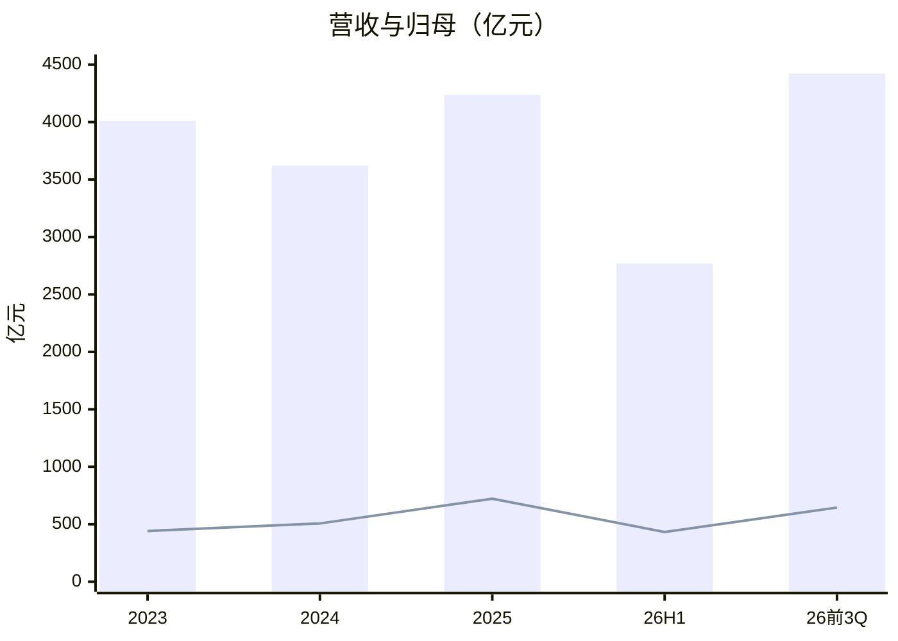

# 宁德时代（300750）价值投研报告

> 财务 2026-09-30；行情与催化 2026-10-22。框架 value-leader-research **2.2.0**。  
> 数据见 `data/`。不构成投资建议；情景价值带 ≠ 买卖指令。

## 1. 摘要

**一句话：** 全球电池龙头「量仍在、利在让」；现价 220 贴近中性隐含带下沿，中性中枢约 **242 元**，贵贱绑定利润率与税负传导。

| 指标 | 数值 |
|------|------|
| 现价 / 市值 | 220.41 元 / 1.02 万亿 |
| PE TTM / PB / PB-ROE | 11.63 / 2.64 / **9.04%** |
| 五年 PE·PB 分位 | ~0.08% |
| 中性隐含价值带 / 中枢 | **223–260 / ≈242** |
| 2026 前三季度收入/归母 | 4421 亿（+56%）/ 645 亿（+32%） |
| Q3 毛利率 / 前三季度 CFO | **20.69%** / 616 亿（**−24%**） |
| 自 2026-05-06 高点 | 460 → 220，**−52%** |

主矛盾：利润表扩张 vs 利润率下移 + 现金转化裂口 + 周期制造定价。

---

## 2. 基本面：买的是什么现金流

**生意：** 电化学制造差价（GWh×ASP − 成本税负）→ CFO − CapEx → FCF。

| 创造价值 | 消耗信任 |
|----------|----------|
| 全球动力份额 ~40%；储能高增；应付 1804 &gt; 应收 1129；货币资金 ~3698 亿 | Q3 毛利率 20.7%；消费税/退税；多供自研；CFO −24%；存货 +53% |

2025 年 FCF ~909 亿（现金真实）；2026 前三季度粗算 FCF 仅 ~195 亿。ROE 五年均 23.85%，正被净利率下移威胁。

**分部（H1）：** 动力 1921 亿 / 毛利率 20.6%；储能 533 亿 / 24.0%；材料回收毛利率最高但体量小。

---

## 3. 近 1–2 年结构变化

结构三项：利润率中枢下移、买方多供/自研、税制硬成本。10/20 三季报确认而非创造这些趋势。

---

## 4. 竞争与护城河

| 口径 | 宁德份额 |
|------|----------|
| 全球动力 2026 年 1–7 月 | **39.9%** |
| 中国装车 2026H1 | **46.0%** |
| 储能 2025 | **30.4%** |

五力：购买者与现有竞争**强**；进入壁垒高。评级 **中等偏宽**。同业 PE：宁德 11.6 &lt; 亿纬 15.6 / 国轩 13.5——便宜在 PE，历史 PB 溢价已收敛。

---

## 5. 成长：收入桥 + 利润桥

| 桥 | 中性判断 |
|----|----------|
| 收入（量×价×结构） | 前三季度 +56%；全年约 +40%（~5900–6100 亿） |
| 利润 | Q3 毛利率 20.7% 打破「全年 24%」旧锚；**2026 归母 ~860 亿（+19%）** |
| 2027–28 | 归母增速约 +12% / +12%；CAGR **~14%** |

vs 一致预期净利 947/1172/1403：本预测更低，差在利润率。乐观/悲观触发：毛利率≥23% 与税负分担 vs 毛利率≤20% 与自吞。

---

## 6. 估值辩论

| 尺子 | 结果 |
|------|------|
| 历史分位 | PE/PB ~0.08%（极底） |
| 前向（一致预期 EPS 20.5） | 10.8× —— 若分母虚高则假便宜 |
| 前向（中性 EPS ~18.6） | ~11.9×；PEG~0.85（用 14% CAGR） |
| PB-ROE | **9.04%** |

**便宜前提：** 历史极折价 + 收入仍强 + 净现金。  
**该折价前提：** 相对完美 2025 宁德不便宜；一致预期可能高；CFO 脱钩。  
**基线：** 周期龙头 11–12×，安全垫=利润率止跌。

### 情景隐含价值带

| 情景 | EPS | PE | 隐含带 |
|------|-----|-----|--------|
| 悲观 | ~17.3 | 10–11× | 173–190 |
| **中性** | **~18.6** | **12–14×** | **223–260（中枢≈242）** |
| 乐观 | ~20–20.5 | 14–16× | 280–328 |

现价 220 ≈ 中性下沿。卖方若用 EPS 20.5×16–18× 会得到更高「目标价」，差在分母与倍数锚。上表为情景算术，非买卖指令。

---

## 7. 市场看法

叙事：利润率修复牛 → 出海储能估值扩张 → 多供/回购博弈 → **利润再分配**。  
卖方评级仍偏多，但股价与 10/21 后部分 EPS 下修（18.x）说明定价已更悲观。

---

## 8. 涨跌归因与定价情景

| 层 | 结论 |
|----|------|
| 中期 | 460→220，主杀估值与利润率预期 |
| 近端 | **10/20 三季报不及预期** + 摩通降级 + 排产数据 |

| 情景 | 含义 |
|------|------|
| 毛利率企稳+税负传导 | 倍数有修复空间 |
| 基线胶着 | 维持周期锚 |
| 毛利率再下台阶 | 收入好也难抬估值 |
| 客户冲击升级 | 质量溢价再压 |

---

## 9. Investment Debate

### 便宜 ≥3

1. 五年 PE/PB 分位约 0.1%，PB-ROE 9%。  
2. 收入与份额桥未断。  
3. 厚现金 + 回购已成交 33 亿。

### 贵/折价 ≥3

1. 相对无税负/高净利率的旧宁德，11× 含理性折价。  
2. 一致预期 947 vs 中性 860 → 假便宜风险。  
3. 利润 +32%、CFO −24%。

### 中性基线

2026 归母 **850–870 亿**、份额不崩、接受净利率下移 → 现价是周期龙头定价；中性隐含中枢 **≈242**；跟踪毛利率与税负使价值带上下移。

### 证伪

| 强化便宜 | 削弱便宜 |
|----------|----------|
| 单季毛利率≥23%；CFO 转正 | 毛利率≤19%；再主销流失；税负自吞 |

### 跟踪

2026 年报/三季报后的毛利率、CFO/净利、月度装车份额、回购进度、消费税分担披露。

---

**免责声明：** 仅供研究整理，不构成投资建议。分册见同目录 `01`–`09`；总览见 `00-总览.md`。
