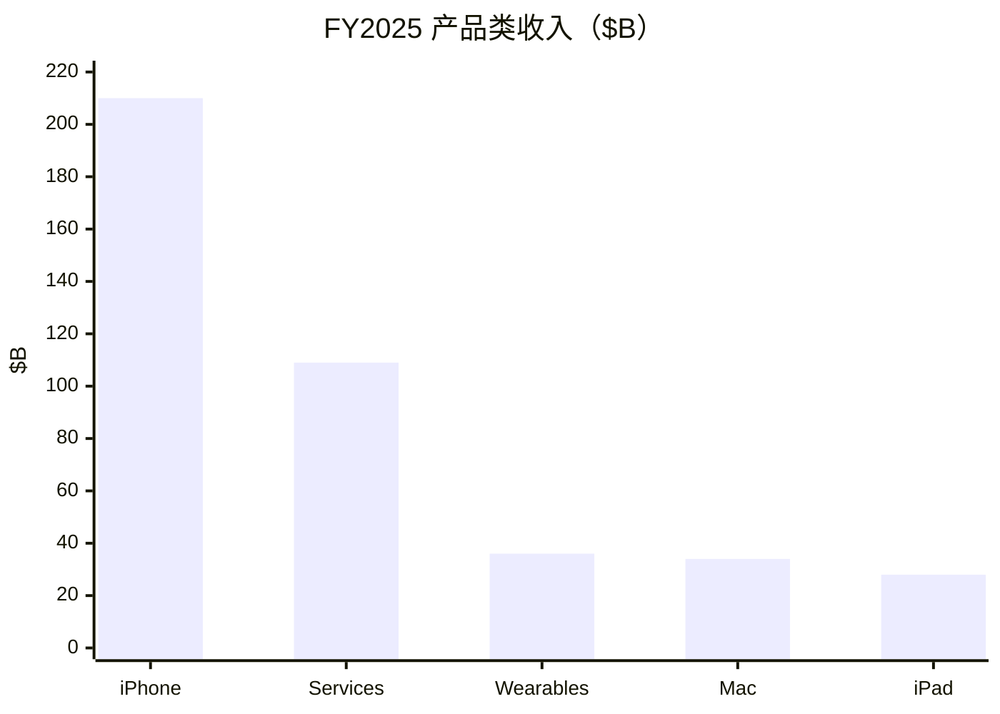

# 苹果（AAPL）投研总览

> 上市地 **US**。财务 **FY2025 + FY2026 Q3**；催化 **2026-10-22**；行情 **2026-10-21**。  
> 框架 **platform-leader-research**；**SOTP 已完成**。不构成投资建议。

## 一句话判断

质量顶级、FCF **$137B**，但市值 **$5.02T**、前瞻 PE ~**37** 已高于卖方目标价与中性 SOTP；近端 Pro 需求存疑，等 **11-02** 财报验证。

## 关键指标

| 指标 | 值 |
|------|-----|
| 股价 / 市值 | $343.99 / **$5.02T** |
| 前瞻 PE / FCF yield | **37.5** / **2.7%** |
| TTM 收入 / OI / FCF | $466.8B / $154.9B / **$136.7B** |
| FY25 iPhone / Services | $209.6B / **$109.2B** |
| Q3'26 收入 / iPhone | $109.4B（+16%）/ $54.3B（+22%） |
| 中性 SOTP（约） | **~$3.7T** vs 市值 $5.0T |
| 卖方目标价均值 | **$329（低于现价）** |
| 下一财报 | **2026-11-02** |

## 关键图

## 单独报告

→ [苹果-投研报告.md](苹果-投研报告.md)

## 各章浓缩

| 章 | 一句结论 | 关键数 |
|----|----------|--------|
| [01](01-投资摘要.md) | 平台框架；质量高、估值满 | 市值 $5.02T |
| [02](02-分板块业务.md) | iPhone 半壁；Services 高毛利 | Services GM ~75% |
| [03](03-近1-2年重大变化.md) | AI 投入+涨价+中国再平衡 | 指引 +9–11% |
| [04](04-成熟主业分析.md) | 硬件中低增成熟锚 | iPhone CAGR 4–8% |
| [05](05-颠覆与代际风险.md) | 敞口中；怕换机+中国 | Pro 订单削减 |
| [06](06-分板块竞争与护城河.md) | 生态宽 | 装机 >25 亿 |
| [07](07-治理与资本配置.md) | 回购机器；低 Capex | 9M 回购 $62B |
| [08](08-成长情景.md) | 中性收入 7–11% | 贴近卖方 |
| [09](09-现阶段估值（SOTP）.md) | SOTP ~$3.7T << 市值 | PE 37× |
| [10](10-市场看法如何演变.md) | 目标价落后于股价 | 目标 $329 |
| [11](11-近期大涨大跌归因.md) | Pro 需求叙事 | 盯 11-02 |
| [12](12-综合判断与跟踪清单.md) | 好公司偏贵 | 跟踪表 |

## 目录

- [01](01-投资摘要.md) … [12](12-综合判断与跟踪清单.md)
- [苹果-投研报告](苹果-投研报告.md)
- [data/](data/)
