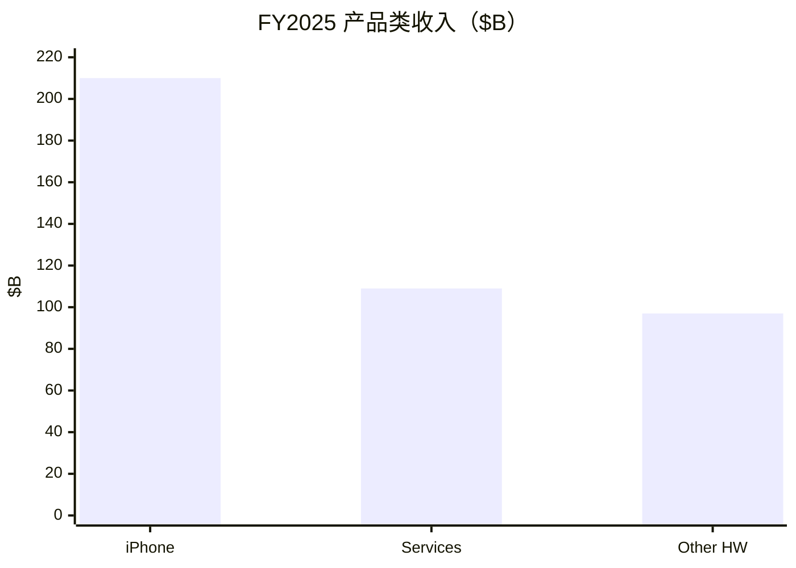
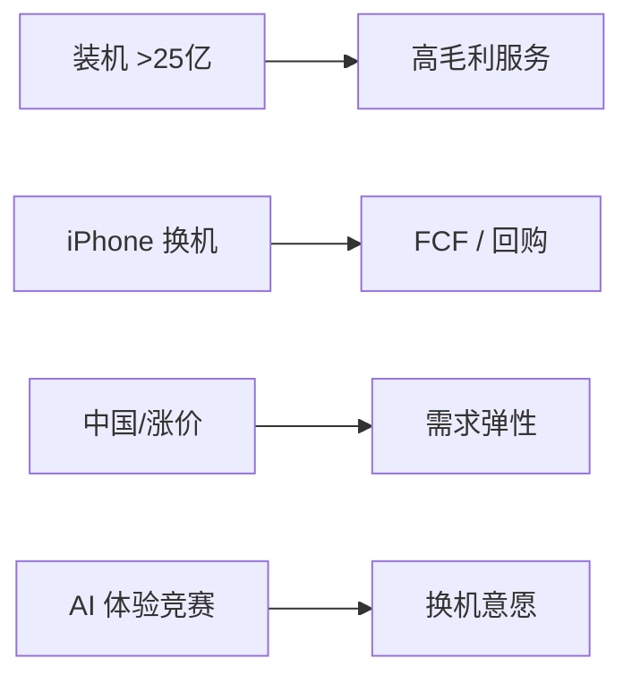
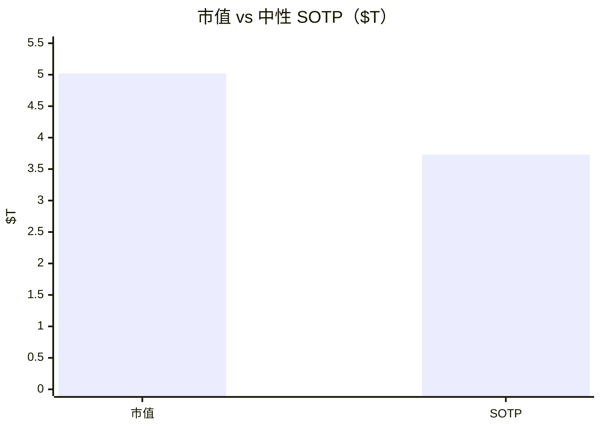

# 苹果（AAPL）投研报告

> US｜platform-leader-research｜SOTP 已完成  
> 财务 FY2025 + FY2026 Q3｜行情 2026-10-21｜催化 2026-10-22  
> **不构成投资建议。**

## 结论

苹果是「成熟硬件生态 + Services/AI 高方差」的典型：**iPhone** 仍贡献约一半收入，**Services** FY25 已达 **$109B**（毛利率约 75%），装机 **>25 亿**，TTM FCF **$137B**、股东回报约 **2.4%**。但市值 **$5.02T**、前瞻 PE ~**37**，**高于卖方目标价均值 $329**，中性 SOTP 约 **$3.7T**——质量顶级，现价偏满；近端 iPhone 18 Pro 订单削减与中国信号增加假期季不确定性。

## 1. 摘要

| 项 | 内容 |
|----|------|
| 框架 | platform-leader |
| 一句话 | 现金牛极强；估值要求过高增速 |
| 下一催化 | **2026-11-02** FY26 Q4 |

## 2. 分板块

| 类目 | FY25 | Q3'26 | YoY |
|------|------|-------|-----|
| iPhone | $209.6B | $54.3B | +22% |
| Services | $109.2B | $30.7B | +12% |
| Mac / iPad / Wearables | $33.7 / $28.0 / $35.7B | $10.4 / $6.2 / $7.9B | +29% / −6% / +6% |

Q3 收入 $109.4B（+16%）；大中华 $18.8B（+22%）。毛利率 50.1%（含关税退税约 2pp）。**无官方分产品 OI。**

## 3–4. 变化与成熟主业

结构：AI 研发费用上升、高端涨价、中国再平衡。iPhone 中性 CAGR **4–8%**；禁止外推单季 +22%。

## 5–6. 颠覆与护城河

敞口 **中**：换机证伪、中国、监管伤 Services。生态护城河 **宽**，但估值放大负面催化。

## 7–8. 资本与成长

9M 回购 **$62B**；Capex 极低。中性集团收入 CAGR **7–11%**（贴近卖方 ~11%）；现价隐含更乐观。

## 9. SOTP（中性，OI 为推算）

| 板块 | 归因 OI（约） | 倍数 | 价值 |
|------|---------------|------|------|
| Services | $65B | 26× | ~$1.69T |
| Hardware | $90B | 22× | ~$1.98T |
| 净现金 | | | +$0.06T |
| **股权** | | | **~$3.73T** |
| 市值 | | | **$5.02T** |

市场更贵在 **硬件周期与 AI 叙事**；FCF 锚指向更低中枢。

## 10–11. 看法与涨跌

卖方目标价落后于股价；近端主因 **Pro 需求/订单下调** 与中国渠道。下一验证 **11-02**。

## 12. 跟踪

假期季指引、大中华、Services 增速与监管、回购节奏。免责：研究练习非投资建议。

分册：[00-总览](00-总览.md)
