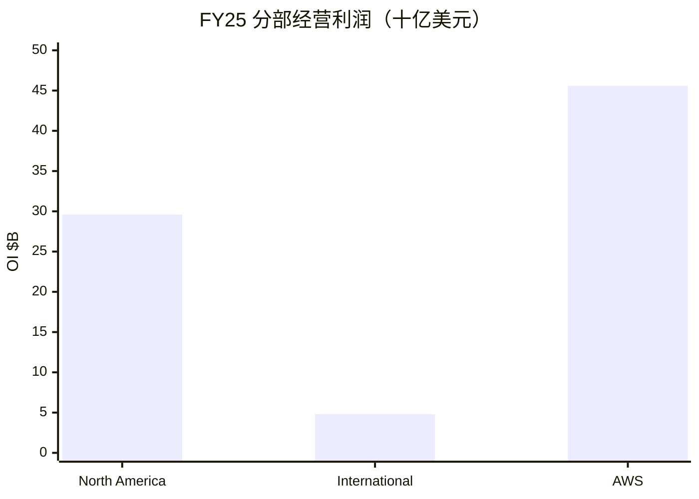

# 亚马逊（AMZN）投研总览

> 上市地 **US**。财务时点 **FY2025 + Q2/H1 2026**；催化时点 **2026-10-22**；行情 **2026-10-21**。  
> 框架 **platform-leader-research**；**SOTP 已完成**。不构成投资建议。

## 一句话判断

北美零售+广告是成熟锚，AWS +37% 贡献约六成经营利润；**$220B capex** 打负 FCF，市值 **$2.83T** 接近中性 SOTP，对开支回报节奏仍敏感。

## 关键指标

| 指标 | 值 |
|------|-----|
| 股价 / 市值 / EV | $262.37 / **$2.83T** / $2.96T |
| 前瞻 PE / TTM PE | **27.9** / 21.1（TTM 含投资收益） |
| TTM 收入 / 经营利润 | $775.7B / **$93.7B** |
| TTM FCF / yield | **−$11.6B** / −0.4% |
| FY25 OI：NA / Intl / AWS | $29.6 / $4.8 / **$45.6B** |
| Q2 AWS | $42.2B 收入（+37%）；OI $16.6B |
| 中性 SOTP（约） | **~$2.9T** vs 市值 $2.83T |
| 卖方目标价均值 | $331（60 人 Strong Buy） |
| 下一财报 | **2026-10-29** |

## 关键图

## 单独报告

→ [亚马逊-投研报告.md](亚马逊-投研报告.md)

## 各章浓缩

| 章 | 一句结论 | 关键数 |
|----|----------|--------|
| [01](01-投资摘要.md) | 平台框架匹配；锚在北美、方差在 AWS | 市值 $2.83T |
| [02](02-分板块业务.md) | 三分部硬表齐全；利润已偏云 | AWS 占 OI ~57% |
| [03](03-近1-2年重大变化.md) | 结构变：资本密度跃升 | Capex ~$220B |
| [04](04-成熟主业分析.md) | 北美中低速成熟锚 | NA CAGR 8–12% |
| [05](05-颠覆与代际风险.md) | 敞口中高：开支与分流 | FTC 广告诉 |
| [06](06-分板块竞争与护城河.md) | 北美中偏宽、AWS 宽、国际中 | 对手 Azure/Walmart |
| [07](07-治理与资本配置.md) | 再扩张年；回报让位于 capex | 无分红 |
| [08](08-成长情景.md) | 中性收入 CAGR 12–16% | 接近卖方 ~15% |
| [09](09-现阶段估值（SOTP）.md) | 中性 SOTP ~$2.9T ≈ 市值 | FCF yield 负 |
| [10](10-市场看法如何演变.md) | 叙事：修复→开支焦虑→AWS 对冲 | 目标价 $331 |
| [11](11-近期大涨大跌归因.md) | 近端宏观 β；中期盯 capex | 下一看 10-29 |
| [12](12-综合判断与跟踪清单.md) | 优质平台合理价；盯 FCF 拐点 | 跟踪表齐全 |

## 目录

- [01-投资摘要](01-投资摘要.md)
- [02-分板块业务](02-分板块业务.md)
- [03-近1-2年重大变化](03-近1-2年重大变化.md)
- [04-成熟主业分析](04-成熟主业分析.md)
- [05-颠覆与代际风险](05-颠覆与代际风险.md)
- [06-分板块竞争与护城河](06-分板块竞争与护城河.md)
- [07-治理与资本配置](07-治理与资本配置.md)
- [08-成长情景](08-成长情景.md)
- [09-现阶段估值（SOTP）](09-现阶段估值（SOTP）.md)
- [10-市场看法如何演变](10-市场看法如何演变.md)
- [11-近期大涨大跌归因](11-近期大涨大跌归因.md)
- [12-综合判断与跟踪清单](12-综合判断与跟踪清单.md)
- [亚马逊-投研报告](亚马逊-投研报告.md)
- [data/](data/)
