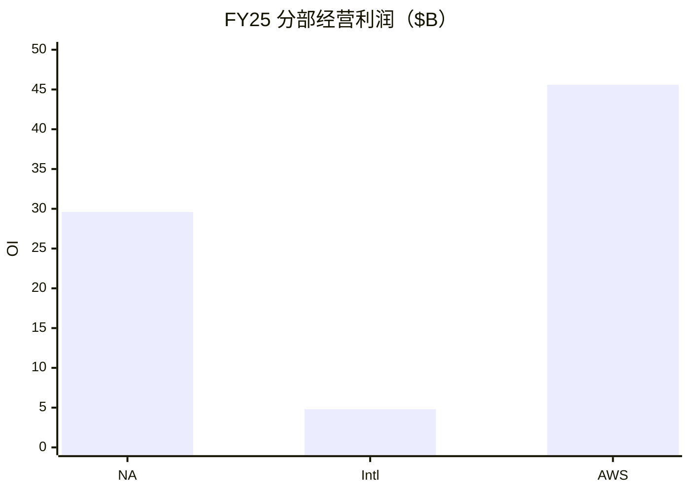
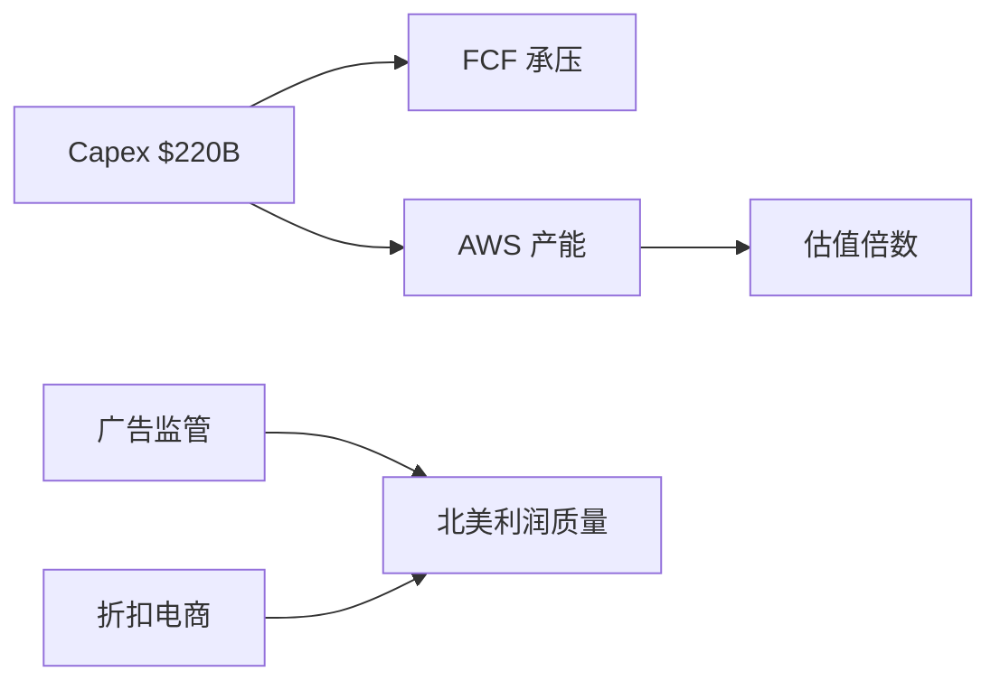
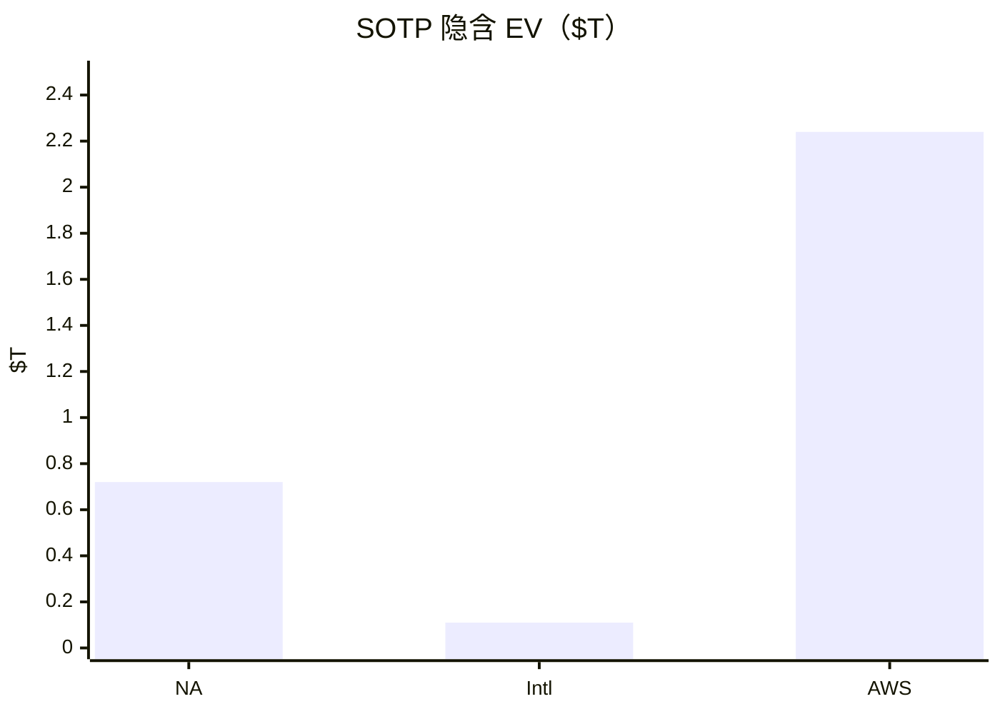

# 亚马逊（AMZN）投研报告

> US｜platform-leader-research｜SOTP 已完成  
> 财务 FY2025 + Q2/H1 2026｜行情 2026-10-21｜催化 2026-10-22  
> **不构成投资建议。**

## 结论

亚马逊符合「成熟主业 + 颠覆高方差」：北美零售生态贡献收入主体与扎实经营利润，广告与 Prime 抬高质量；**AWS** 在 Q2 收入 **$42.2B（+37%）**、经营利润 **$16.6B**，已成利润与估值方差核心。现价 **$262.37 / 市值 $2.83T**，前瞻 PE ~**28**，TTM FCF **净流出**（FY26 现金 capex 指引约 **$220B**）。中性 SOTP 约 **$2.9T**，与市值大致相当——偏「合理价的优质平台」，脆弱点在 **AI 开支回报**，而非明年零售是否还能赚钱。

## 1. 摘要

| 项 | 内容 |
|----|------|
| 框架 | platform-leader（非 value / 非纯 growth） |
| 一句话 | 零售锚 + 云/AI 期权；capex 决定倍数 |
| 下一催化 | **2026-10-29** Q3 业绩 |

## 2. 分板块

| 板块 | FY25 收入 | FY25 OI | 阶段 |
|------|-----------|---------|------|
| North America | $426.3B | $29.6B | 成熟 |
| International | $161.9B | $4.75B | 过渡 |
| AWS | $128.7B | $45.6B | 增长 |

Q2：合并收入 $200.6B（+20%），OI $27.5B；AWS 约占 OI **60%**。广告产品组 Q2 **$19.8B（+26%）**。净利 $62.6B 含 Anthropic 等 **non-op $53.4B**——须与经营分列。

## 3–4. 变化与成熟主业

结构主线：从「零售利润率修复」切到「**高 capex 换 AWS 加速**」。北美中性收入 CAGR 约 **8–12%**；国际看提效；禁止把成熟零售写成无限赛道。

## 5–6. 颠覆与护城河

敞口 **中高**。最危险：① AI capex 回报时滞；② 云竞争/客户自建 + 折扣电商分流。分板块：北美 **中偏宽**、国际 **中**、AWS **宽但可破**。

## 7–8. 资本与成长

再扩张年：无分红、股本略增；资本优先 AWS/AI。中性集团收入 CAGR **12–16%**（接近卖方 ~15%）；AWS 中性 **20–28%**，不外推单季 +37%。

## 9. SOTP（中性）

| 板块 | 关键 OI（约） | 倍数 | 隐含 EV |
|------|---------------|------|---------|
| North America | $36B | 20× | ~$0.72T |
| International | $7B | 16× | ~$0.11T |
| AWS | $70B | 32× | ~$2.24T |
| 减净债 | | | −$0.13T |
| **股权** | | | **~$2.94T** |
| 市值 | | | **$2.83T** |

市场更贵在 **AWS/AI 期权**；FCF yield 为负意味着仍在为产能付费。

## 10–11. 看法与涨跌

叙事：利润率修复 → 开支焦虑 → AWS 加速对冲 → 10 月宏观再压。近端主因 **利率/Mag7 β** 与 **capex/FCF 质疑**；无人机枢纽等为次级噪音。

## 12. 跟踪

盯：10-29 后 AWS 斜率、capex 指引是否见顶、TTM FCF 拐点、广告诉讼、零售分流。免责：研究练习非投资建议。

分册：[00-总览](00-总览.md)
