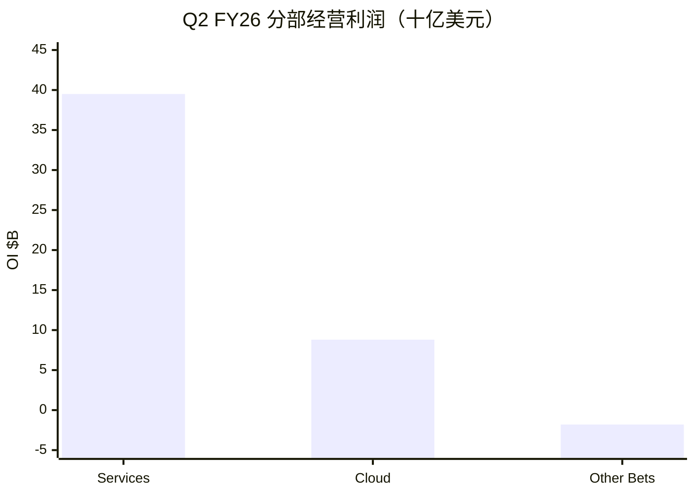

# 谷歌 / Alphabet（GOOGL）投研总览

> 上市地 **US**。财务时点 **FY2025 + Q2 2026**；催化时点 **2026-10-22**；行情 **2026-10-21**。  
> 框架 **platform-leader-research**；**SOTP 已完成**。不构成投资建议。

## 一句话判断

Search/YouTube 现金牛扎实，Cloud Q2 **+82%**、backlog **$514B**；**Capex $195–205B** 压低 FCF yield 至约 **1.3%**，市值 **$4.09T** 略低于中性 SOTP，对算力回报与搜索变现仍敏感。

## 关键指标

| 指标 | 值 |
|------|-----|
| 股价 / 市值 / EV | $334.76 / **$4.09T** / $3.97T |
| 前瞻 PE / TTM PE | **25.0** / 16.8（TTM 含股权浮盈） |
| TTM 收入 / 经营利润 | $445.9B / **$147.6B** |
| TTM FCF / yield | $53.3B / **1.3%** |
| FY25 Services / Cloud OI | **$139.4B** / $13.9B |
| Q2 Cloud | $24.8B（+82%）；OI $8.8B；backlog **$514B** |
| 中性 SOTP（约） | **~$4.6T** vs 市值 $4.09T |
| 卖方目标价均值 | $431（62 人 Strong Buy） |
| 下一财报 | **2026-10-28** |

## 关键图

## 单独报告

→ [谷歌-投研报告.md](谷歌-投研报告.md)

## 各章浓缩

| 章 | 一句结论 | 关键数 |
|----|----------|--------|
| [01](01-投资摘要.md) | 平台框架匹配；锚在 Services、方差在 Cloud | 市值 $4.09T |
| [02](02-分板块业务.md) | 三分部+Alphabet-level；利润仍偏广告 | Services OI 利润率 42% |
| [03](03-近1-2年重大变化.md) | 结构变：资本密度与股权融资 | Capex $195–205B |
| [04](04-成熟主业分析.md) | Search 成熟锚，中低高增 | Services CAGR 9–13% |
| [05](05-颠覆与代际风险.md) | 敞口中高：入口+Capex | 让产 DeepMind |
| [06](06-分板块竞争与护城河.md) | Search/YT 宽，Cloud 中偏宽 | backlog $514B |
| [07](07-治理与资本配置.md) | 再扩张；融资+开支并行 | 股权融资 $49.6B |
| [08](08-成长情景.md) | 中性收入 CAGR 14–20% | 低于卖方 ~23% |
| [09](09-现阶段估值（SOTP）.md) | 中性 SOTP ~$4.6T > 市值 | FCF yield 1.3% |
| [10](10-市场看法如何演变.md) | 叙事：云加速→开支焦虑→让产 | 目标价 $431 |
| [11](11-近期大涨大跌归因.md) | 近端让产+财报前减仓 | 下一看 10-28 |
| [12](12-综合判断与跟踪清单.md) | 优质平台合理略便宜；盯 FCF | 跟踪表齐全 |

## 目录

- [01](01-投资摘要.md) … [12](12-综合判断与跟踪清单.md)
- [谷歌-投研报告](谷歌-投研报告.md)
- [data/](data/)
