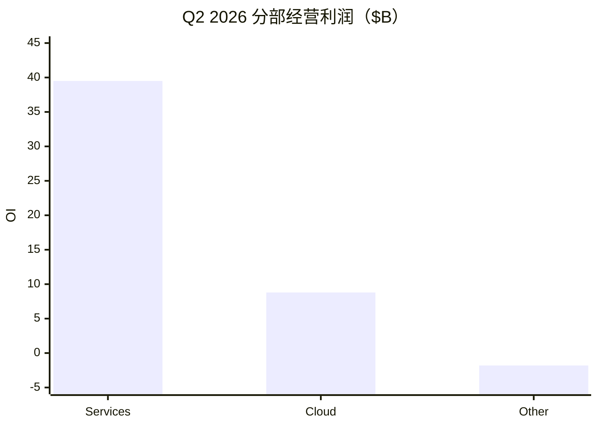
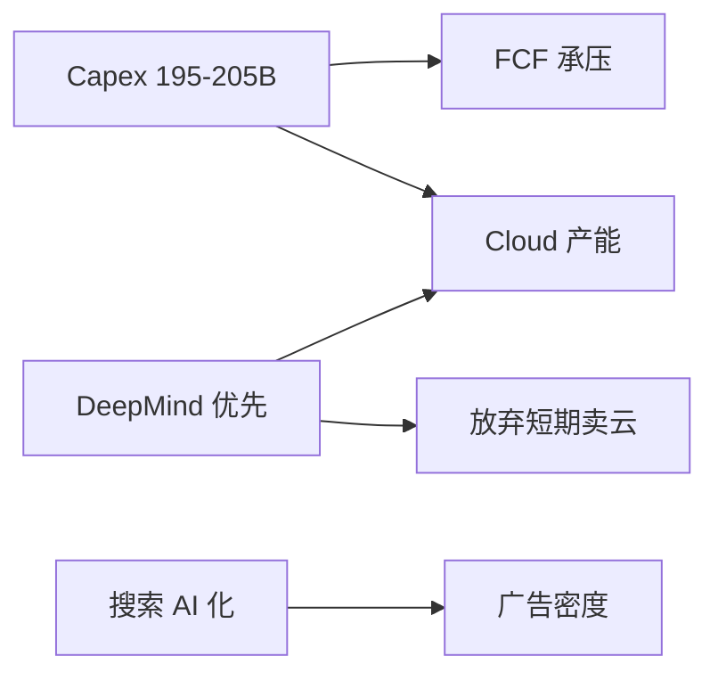
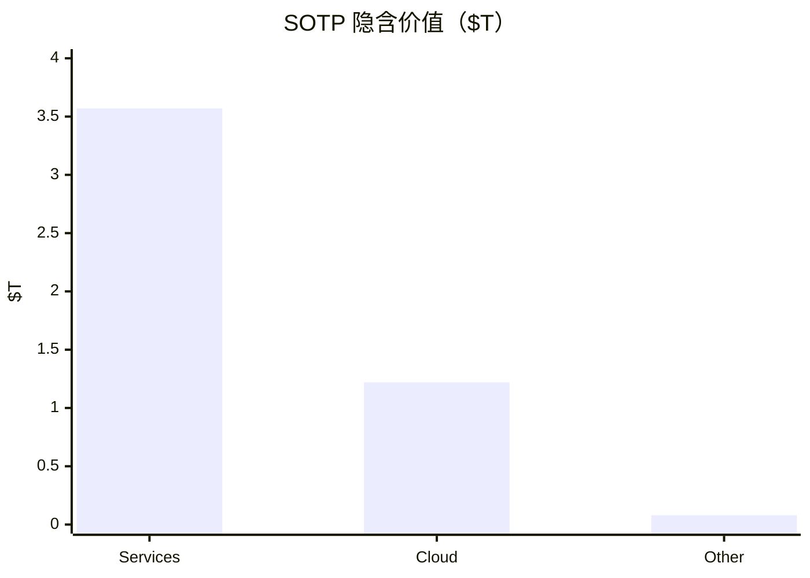

# 谷歌 / Alphabet（GOOGL）投研报告

> US｜platform-leader-research｜SOTP 已完成  
> 财务 FY2025 + Q2 2026｜行情 2026-10-21｜催化 2026-10-22  
> **不构成投资建议。**

## 结论

Alphabet 符合「成熟主业 + 颠覆高方差」：**Google Services**（Search/YouTube/订阅）贡献超高利润率现金牛；**Google Cloud** Q2 收入 **$24.8B（+82%）**、经营利润 **$8.8B**、backlog **$514B**，是成长与叙事方差核心。现价 **$334.76 / 市值 $4.09T**，前瞻 PE ~**25**，TTM FCF **$53B**（yield **1.3%**），但单季 FCF 已转负、FY26 Capex 指引 **$195–205B**。中性 SOTP 约 **$4.6T**，略高于市值——偏「合理略便宜的优质平台」，脆弱点在 **AI 开支回报与搜索入口代际**，而非明年广告是否还能赚钱。

## 1. 摘要

| 项 | 内容 |
|----|------|
| 框架 | platform-leader（非 value / 非纯 growth） |
| 一句话 | 广告锚 + 云/AI 期权；Capex 与算力分配决定倍数 |
| 下一催化 | **2026-10-28** Q3 业绩 |

## 2. 分板块

| 板块 | FY25 收入 | FY25 OI | Q2'26 收入 | Q2'26 OI |
|------|-----------|---------|------------|----------|
| Google Services | $342.7B | $139.4B | $94.5B（+15%） | $39.5B |
| Google Cloud | $58.7B | $13.9B | $24.8B（+82%） | $8.8B |
| Other Bets | $1.5B | −$7.5B | $0.4B | −$1.8B |

Q2 合并收入 $119.8B（+24%），OI $40.8B；净利 $112B 含股权证券浮盈约 **$99B**——须与经营分列。Search +17%，YouTube ads +13%，Network −1%。

## 3–4. 变化与成熟主业

结构主线：全栈 AI + Capex 跃升 + 2026-06 股权融资 ~$50B。Services 中性收入 CAGR 约 **9–13%**；禁止把 Search 写成无依据永续高增。

## 5–6. 颠覆与护城河

敞口 **中高**。最危险：① 搜索被 AI 入口旁路且广告密度下降；② Capex 无法转化为 Cloud/FCF。近端增量：Cloud 为 DeepMind **放弃短期收入**。护城河：Search/YouTube **宽**，Cloud **中偏宽**，Other **未定**。

## 7–8. 资本与成长

再扩张年：分红+小幅回购仍在，但资本主旋律是算力；2027 Capex 公司暗示再升。中性集团收入 CAGR **14–20%**（卖方约 23% 偏乐观）；Cloud 中性 **30–45%**，不外推 +82%。

## 9. SOTP（中性）

| 板块 | 关键 OI（约） | 倍数 | 隐含价值 |
|------|---------------|------|----------|
| Google Services | $155B | 23× | ~$3.57T |
| Google Cloud | $38B | 32× | ~$1.22T |
| Other Bets 期权 | — | — | ~$0.08T |
| Alphabet-level 拖累 | — | — | −$0.35T |
| 净现金 | | | +$0.12T |
| **股权** | | | **~$4.64T** |
| 市值 | | | **$4.09T** |

市场更贵在 **Cloud/AI**；FCF yield 低意味着仍在为产能付费。

## 10–11. 看法与涨跌

叙事：云加速 → 开支焦虑 → 让产显性化。近端主因 **Pichai 算力取舍评论**、财报前减仓与目标价微调；中期主轴仍是 Capex/FCF。

## 12. 跟踪

盯：10-28 后 Cloud 斜率与指引、Capex 是否见顶、季度 FCF、Search RPM、融资稀释。免责：研究练习非投资建议。

分册：[00-总览](00-总览.md)
