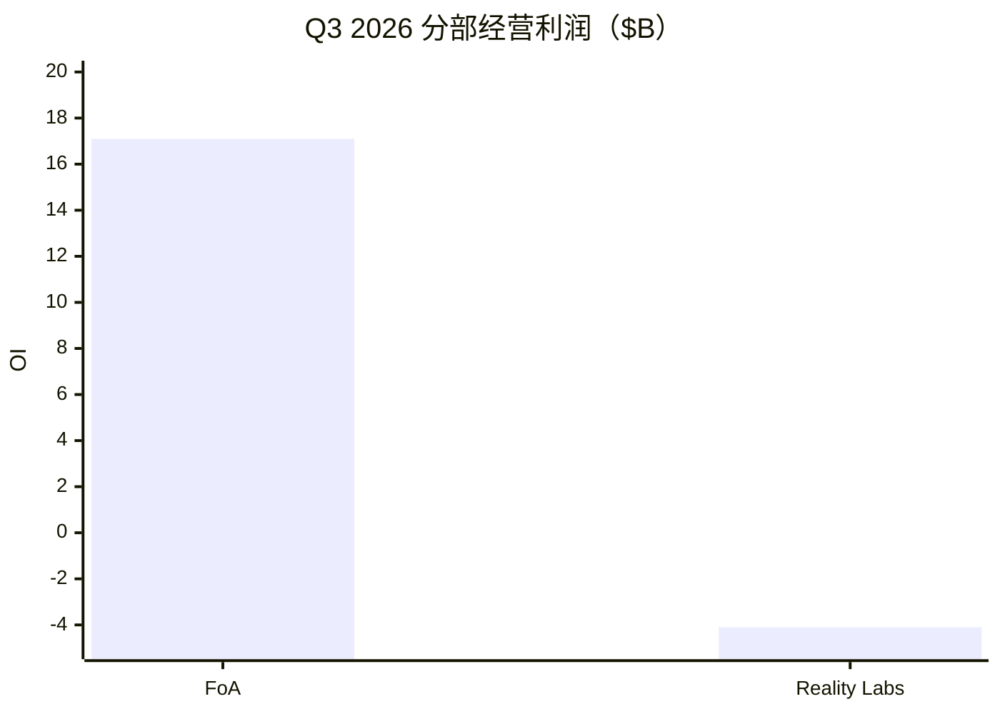

# Meta（META）投研总览

> 上市地 **US**。财务 **FY2025 + Q2/Q3 2026**；催化 **2026-10-21 Q3**；行情收盘 **2026-10-21**。  
> 框架 **platform-leader-research**；**SOTP 已完成**。不构成投资建议。

## 一句话判断

FoA 广告 +26% 仍强，但 **Capex $135–145B** 打出单季负 FCF，叠加诉讼费用与 **Class C**；市值 **$1.78T** 略低于中性 SOTP，对开支回报与稀释敏感。

## 关键指标

| 指标 | 值 |
|------|-----|
| 收盘 / 盘后约 | $697.52 / **~$713** |
| 市值 / EV | **$1.78T** / $1.81T |
| 前瞻 PE / TTM FCF yield | **21** / **1.6%** |
| Q3 收入 / OI | $64.6B / $13.0B（剔诉讼 ~$22.9B） |
| Q3 FoA / RL | 收入 $64.2B / $0.44B；OI $17.1B / −$4.1B |
| FY26 Capex 指引 | **$135–145B** |
| 中性 SOTP | **~$1.92T** vs $1.78T |
| 卖方目标价 | $815 |
| Q4 收入指引 | **$73–76B** |

## 关键图

## 单独报告

→ [Meta-投研报告.md](Meta-投研报告.md)

## 各章浓缩

| 章 | 一句结论 | 关键数 |
|----|----------|--------|
| [01](01-投资摘要.md) | 平台框架；锚 FoA、方差 AI/RL | 市值 $1.78T |
| [02](02-分板块业务.md) | 广告几乎全部利润 | FoA FY25 OI $102B |
| [03](03-近1-2年重大变化.md) | Capex+诉讼+Class C | 和解最高 $18.6B |
| [04](04-成熟主业分析.md) | 广告成熟中高增 | 不外推 +26% |
| [05](05-颠覆与代际风险.md) | 敞口中高 | Capex+稀释 |
| [06](06-分板块竞争与护城河.md) | FoA 宽、RL 未定 | 对手 TikTok/YT |
| [07](07-治理与资本配置.md) | 再扩张；回购暂停 | Class C 2027-01 |
| [08](08-成长情景.md) | 中性收入 12–18% | 低于卖方 ~22% |
| [09](09-现阶段估值（SOTP）.md) | SOTP ~$1.9T | FCF yield 1.6% |
| [10](10-市场看法如何演变.md) | 效率→广告AI→军备 | 目标价 $815 |
| [11](11-近期大涨大跌归因.md) | 盘后看收入强 | AH +2% |
| [12](12-综合判断与跟踪清单.md) | 合理略便宜；盯 FCF/Class C | 跟踪表 |

## 目录

- [01](01-投资摘要.md) … [12](12-综合判断与跟踪清单.md)
- [Meta-投研报告](Meta-投研报告.md)
- [data/](data/)
