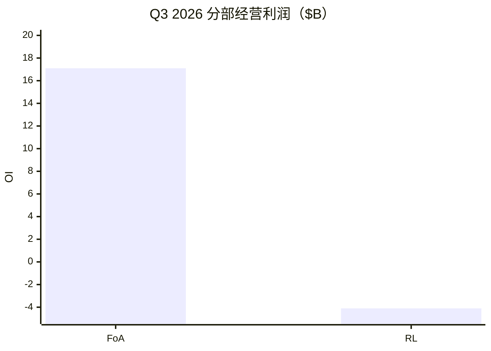
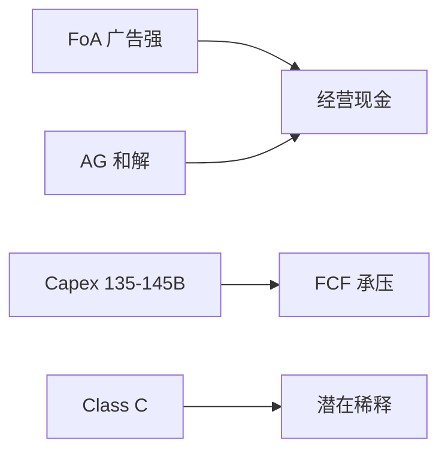
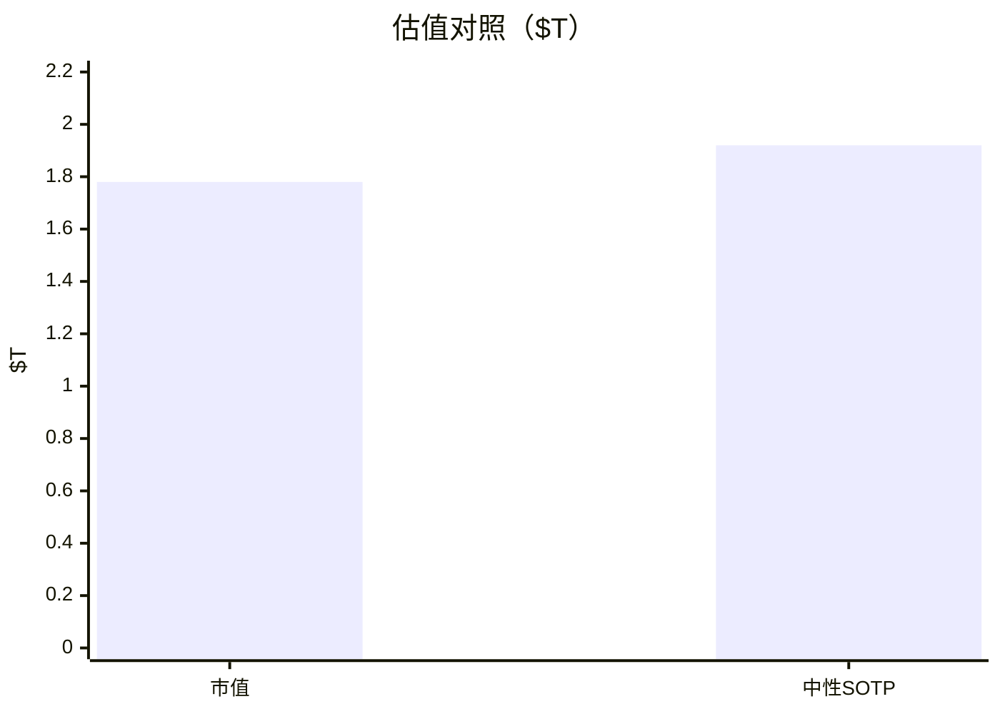

# Meta（META）投研报告

> US｜platform-leader-research｜SOTP 已完成  
> 财务至 **Q3 2026**｜行情 2026-10-21｜催化 Q3 盘后  
> **不构成投资建议。**

## 结论

Meta 符合「成熟主业 + 颠覆高方差」：**Family of Apps** 广告 Q3 **$63.1B（+26%）**，价量齐升；**Reality Labs** 仍亏约 **$4.1B**/季。现价收盘 **$697.52 / 市值 $1.78T**（盘后约 $713），前瞻 PE ~**21**，TTM FCF yield **1.6%**，但单季 FCF **−$2.1B**、FY26 Capex **$135–145B**，并宣布 **Class C** 融资架构与最高约 **$18.6B** 州检察和解。中性 SOTP 约 **$1.9T**——偏「合理略便宜的优质广告平台」，脆弱点在 **AI 开支回报与稀释**，而非广告明年是否还能双位数。

## 1. 摘要

| 项 | 内容 |
|----|------|
| 框架 | platform-leader |
| 一句话 | 广告锚 + AI/RL 期权；Capex 与 Class C 决定倍数 |
| 下一关注 | Q4 指引 **$73–76B**；Class C 2027-01 |

## 2. 分板块

| 板块 | FY25 收入 | FY25 OI | Q3'26 收入 | Q3'26 OI |
|------|-----------|---------|------------|----------|
| Family of Apps | $198.8B | +$102.5B | $64.2B（+26%） | $17.1B |
| Reality Labs | $2.2B | −$19.2B | $0.44B | −$4.1B |

合并 Q3 OI $13.0B（含诉讼 **$9.89B**；剔后 ~$22.9B）。DAP 36.4 亿；展示 +10%、单价 +14%。

## 3–4. 变化与成熟主业

结构：AI Capex、裁员、AG 和解、Class C。FoA 中性收入 CAGR **12–18%**，禁止外推 +26%。

## 5–6. 颠覆与护城河

敞口 **中高**：Capex→FCF、监管、Class C 稀释。FoA 护城河 **宽**；RL **未定**。

## 7–8. 资本与成长

回购近端暂停；分红仍在。RL FY26 亏 $18–19B，FY27 指引约 $15B。卖方收入 CAGR ~22% **高于**本报告中性。

## 9. SOTP（中性）

| 板块 | 关键 OI（约） | 倍数 | 价值 |
|------|---------------|------|------|
| FoA | $105B | 18× | ~$1.89T |
| RL 期权 | — | — | ~$0.06T |
| 净债 | | | −$0.03T |
| **股权** | | | **~$1.92T** |
| 市值（收盘） | | | **$1.78T** |

## 10–11. 看法与涨跌

叙事：效率年 → 广告 AI → 军备开支 → 诉讼/Class C。Q3 盘后约 +2%，短线看收入；中期仍盯 FCF 与稀释。

## 12. 跟踪

广告价量、Capex/FCF、Class C 发行规模、RL 亏损、青年监管。免责：研究练习非投资建议。

分册：[00-总览](00-总览.md)
