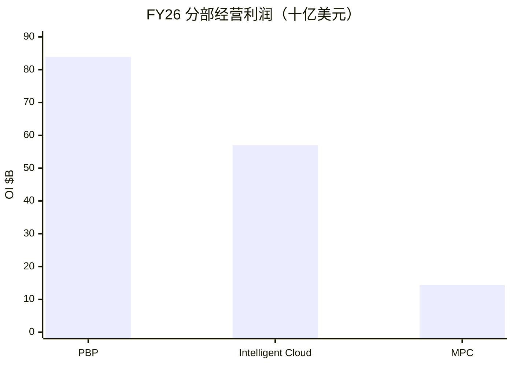

# 微软（MSFT）投研总览

> 上市地 **US**。财务时点 **2026-06-30（FY2026）**；催化时点 **2026-10-22**；行情 **2026-10-21**。  
> 框架 **platform-leader-research**。不构成投资建议。

## 一句话判断

Office 现金牛扎实、Azure 已过千亿美元且 Q4 再加速，但 AI capex 把 FCF yield 压到约 **1.7%**；现价 **$3.96T** 接近中性 SOTP，对开支回报节奏仍敏感。

## 关键指标

| 指标 | 值 |
|------|-----|
| 股价 / 市值 / EV | $532.95 / $3.96T / $4.01T |
| 前瞻 PE / TTM PE | 27.0 / 29.7 |
| FY26 收入 / 经营利润 | $331.8B / $155.2B |
| EPS GAAP / Non-GAAP | $17.95 / $17.28 |
| FCF / yield | $67B / 1.69% |
| PBP / Cloud / MPC 占 OI | 54% / 37% / 9% |
| 卖方目标价均值 | $599（56 人，Strong Buy） |
| 下一财报 | 2026-10-28 |

## 关键图

## 单独报告

→ [微软-投研报告.md](微软-投研报告.md)

## 各章浓缩

| 章 | 一句结论 | 关键数 |
|----|----------|--------|
| [01](01-投资摘要.md) | 平台框架匹配；锚定 PBP、方差在云 | 市值 $3.96T |
| [02](02-分板块业务.md) | 三板块硬表齐全；云与生产力双引擎 | 收入 $332B |
| [03](03-近1-2年重大变化.md) | 结构变：资本密度跃升 | Capex +80% |
| [04](04-成熟主业分析.md) | PBP 高利润成熟锚 | OI 利润率 ~60% |
| [05](05-颠覆与代际风险.md) | 敞口中高：capex 与入口 | 2026-06 重定价 |
| [06](06-分板块竞争与护城河.md) | 办公宽、云中偏宽、MPC 弱 | RPO $678B |
| [07](07-治理与资本配置.md) | 回报仍在，再投资为主旋律 | 回购+分红 $49B |
| [08](08-成长情景.md) | 中性收入 CAGR 14–17% | 低于卖方 ~20% |
| [09](09-现阶段估值（SOTP）.md) | 中性 SOTP ~$4.35T vs $3.96T | FCF yield 1.7% |
| [10](10-市场看法如何演变.md) | 叙事：溢价→开支恐慌→修复 | 目标价 $599 |
| [11](11-近期大涨大跌归因.md) | 跌看 capex，涨看 Azure 加速 | 回撤至多 ~35% |
| [12](12-综合判断与跟踪清单.md) | 优质平台合理偏贵；盯 10-28 | 跟踪表齐全 |

## 目录

- [01-投资摘要](01-投资摘要.md)
- [02-分板块业务](02-分板块业务.md)
- [03-近1-2年重大变化](03-近1-2年重大变化.md)
- [04-成熟主业分析](04-成熟主业分析.md)
- [05-颠覆与代际风险](05-颠覆与代际风险.md)
- [06-分板块竞争与护城河](06-分板块竞争与护城河.md)
- [07-治理与资本配置](07-治理与资本配置.md)
- [08-成长情景](08-成长情景.md)
- [09-现阶段估值（SOTP）](09-现阶段估值（SOTP）.md)
- [10-市场看法如何演变](10-市场看法如何演变.md)
- [11-近期大涨大跌归因](11-近期大涨大跌归因.md)
- [12-综合判断与跟踪清单](12-综合判断与跟踪清单.md)
- [微软-投研报告](微软-投研报告.md)
- [data/](data/)

原始抓取与口径见 `data/fetch_log.md`、`data/research_raw.json`。
