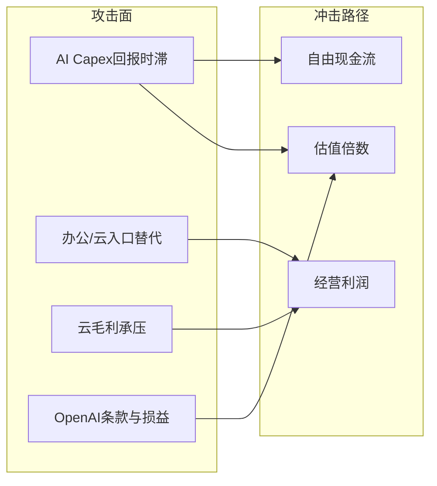

# 5. 颠覆与代际风险｜微软（MSFT）

> 本分册对应 Step 5。上市地 US。催化时点 2026-10-22。不构成投资建议。

## 5.1 攻击面表

| 攻击面 | 证据 | 时间尺度 | 对利润冲击路径 |
|--------|------|----------|----------------|
| **AI 资本开支回报不及预期** | FY26 Capex $116B（+80%）；FCF yield ~1.7%；2026-06 股价因 capex/FCF 重定价单月大跌 | 1–3 年 | 倍数压缩 + 若利用率不足则云毛利率继续承压 |
| **大模型/推理入口被「模型层」或竞品云分流** | OpenAI 合作非完全排他演进；AWS/GCP/自建 GPU 云竞争；自研 Maia 旨在降本 | 2–5 年 | Azure 份额与 AI 附加 ARPU 增速下修 |
| **办公入口被 AI 原生应用替代** | Copilot 嵌入 M365 是防守；若企业改用其他 agent 套件，席位与 ARPU 受压 | 3–5 年 | PBP 高利润率受损（最伤估值锚） |
| **云毛利率因 AI 用量结构恶化** | Microsoft Cloud GM% FY26 降至约 **66%**（公司披露，AI 基建与用量） | 1–2 年 | IC 经营利润增速 < 收入增速 |
| **OpenAI 投资与治理条款** | 权益法损益大幅扰动 GAAP；持股约 27%、估值叙事敏感；IPO 时点不确定 | 1–3 年 | 净利波动、合作分成/Azure 消耗承诺执行风险 |
| **终端与游戏代际** | Xbox 收入下滑、减值；PC OEM 周期 | 1–2 年 | MPC 利润波动（对集团权重有限） |
| **监管（云捆绑/AI 安全/反垄断）** | 持续背景；近端定价主因仍是 capex 而非单一判决 | 2–5 年 | 产品打包受限、合规成本 |

## 5.2 综合判断

| 项 | 判断 |
|----|------|
| 颠覆敞口等级 | **中高**（对「倍数」中高；对「近两年破产式颠覆」仍偏低——分销与切换成本深） |
| 最危险 1–2 个攻击面 | ① **AI capex 回报时滞与 FCF 叙事切换**；② **办公/云入口被下一代 agent 生态改写** |
| 股价已部分反映 | 2026 上半年至 6 月的 capex 恐慌；2026-07 后随 Azure 加速部分修复 |
| 尚未充分反映 | Capex 峰值是否已过、Copilot 变现斜率、OpenAI 条款最终形态 |

禁止空话：「科技变化快」。微软的不对称在于——护城河极深时市值巨大，**一旦市场认定 AI 投入是「沉没成本竞赛」**，倍数压缩可以快于基本面恶化（2026-06 已演示）。

← [04](04-成熟主业分析.md) · → [06](06-分板块竞争与护城河.md)
