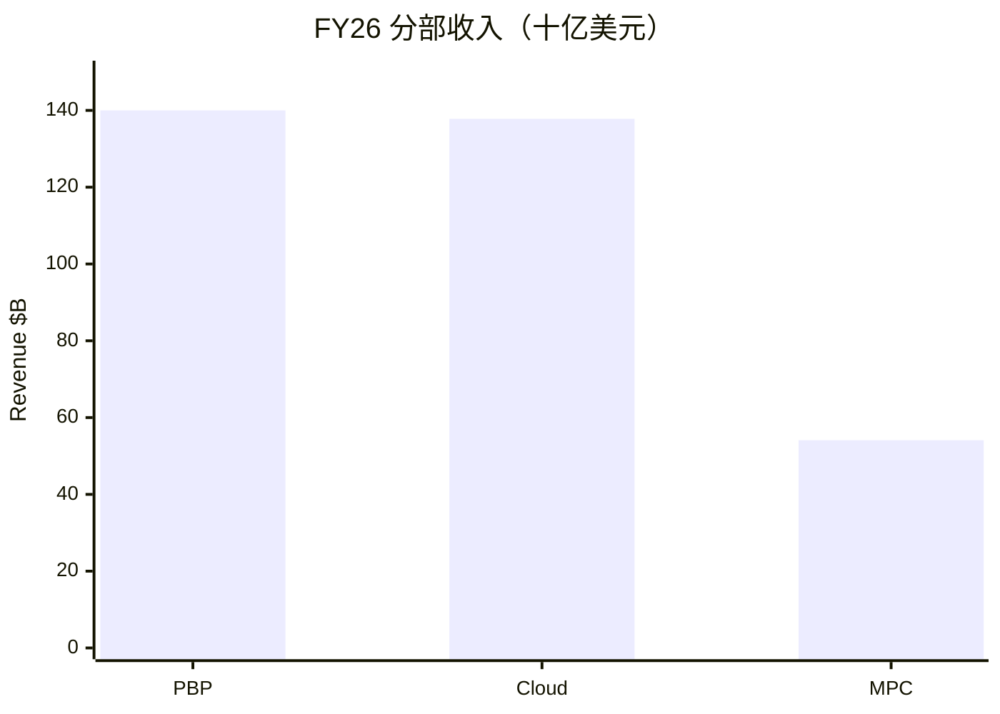
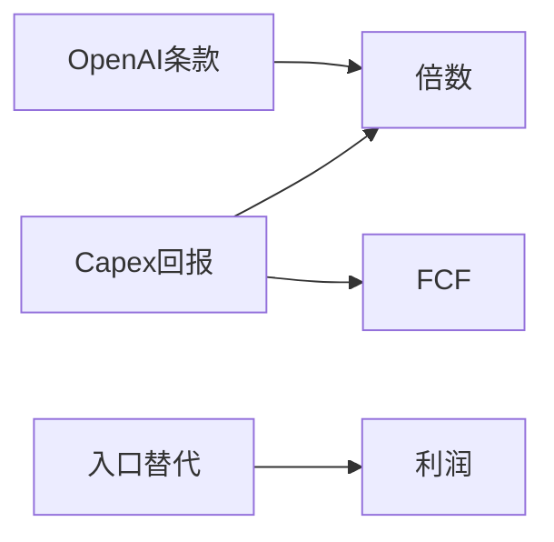
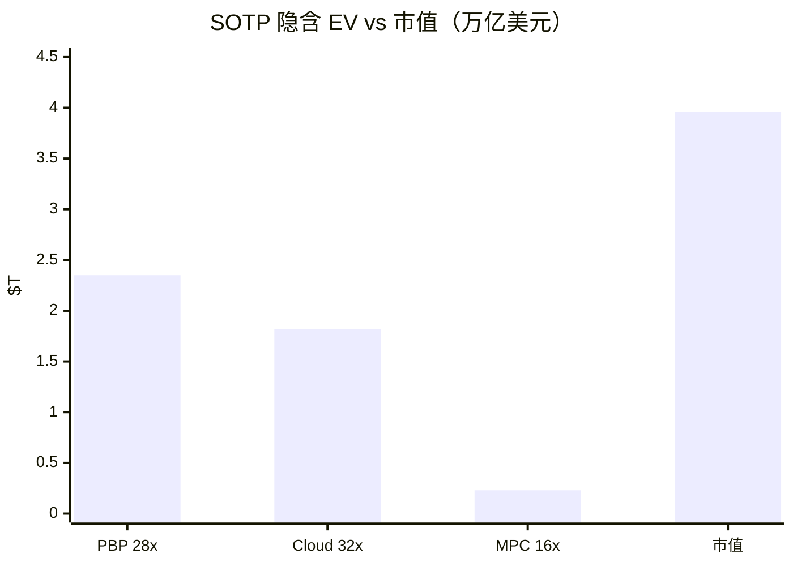

# 微软（MSFT）投研报告

> 上市地 US｜框架 platform-leader-research｜财务 FY2026（2026-06-30）｜行情 2026-10-21｜催化 2026-10-22  
> **不构成投资建议。** GAAP / Non-GAAP 分列。详情见各分册。

## 结论

微软符合「成熟主业 + 颠覆高方差」：PBP 贡献约 **54%** 经营利润并保持约 **60%** 利润率；Intelligent Cloud 收入 **$138B（+30%）**、Azure 年入约 **$102B**，是成长与叙事方差来源；MPC 收入微降。现价 **$532.95 / 市值 $3.96T**，前瞻 PE **~27**，FCF yield **仅 1.7%**（Capex $116B）。中性 SOTP 约 **$4.35T**，略高于市值——偏「合理偏贵的优质平台」，脆弱点在 AI 开支回报而非明年能否继续赚钱。

## 1. 投资摘要

| 项 | 内容 |
|----|------|
| 框架选择 | platform-leader（非纯价值 / 非纯成长放量） |
| 一句话 | 现金牛锚 + 云/AI 期权；capex 决定倍数 |
| 下一催化 | **2026-10-28** FY27 Q1 |

## 2. 分板块业务

| 板块 | 收入 $B | YoY | 经营利润 $B | YoY | 占 OI | 阶段 |
|------|---------|-----|-------------|-----|-------|------|
| Productivity & Business Processes | 140.0 | +16% | 83.9 | +20% | 54% | 成熟 |
| Intelligent Cloud | 137.8 | +30% | 57.0 | +28% | 37% | 过渡/增长 |
| More Personal Computing | 54.1 | −1% | 14.4 | +2% | 9% | 成熟承压 |
| 合计 | 331.8 | +18% | 155.2 | +21% | 100% | |

Microsoft Cloud 汇总收入 **$214.4B**。净利 GAAP **$133.7B** / Non-GAAP（剔 OpenAI）**$128.8B**。

## 3. 近 1–2 年变化

结构主线：从「高 FCF 软件」切到「高 capex AI 平台」。2025-10 起开支上修反复冲击股价；**2026-06** 单月约 −17%~−22%（2000 年以来最差月之一）；**2026-07-29** Azure +43% 带动修复；2026-09 披露 Azure 美元收入并预告分部改组。

## 4. 成熟主业

- **PBP：** 中性收入增速约 11–13%；Copilot 付费席位 >3000 万（管理层）；是 SOTP 锚。  
- **MPC：** Windows/Xbox 承压，搜索广告仍增；难撑集团溢价。

## 5. 颠覆与代际

敞口 **中高**。最危险：① AI capex 回报时滞；② 办公/云入口被 AI 原生生态旁路。云毛利率约 **66%** 已反映 AI 成本。

## 6. 竞争与护城河

| 板块 | 护城河 | 对手 |
|------|--------|------|
| PBP | 宽 | Google Workspace 等 |
| Cloud | 中偏宽（但资本贵） | AWS / GCP |
| MPC | 中→窄 | Sony、Google 搜索 |

商业 RPO **$678B（+84%）** 支撑需求可见度。

## 7. 治理与资本配置

FY26 回购 $22.3B + 分红 $26.4B；Capex $116B 为主矛盾。机构持股约 75%。组织阶段偏再扩张而非纯提效。

## 8. 成长情景

| | 中性 |
|--|------|
| PBP | 收入 CAGR ~11–13% |
| Cloud | 收入 CAGR ~22–28%（前高后缓） |
| 集团 | 收入 CAGR **~14–17%**（低于部分卖方 ~20%） |

乐观看 Azure 维持 40%+ 且 capex 强度下降；悲观看增速与 FCF 双杀。

## 9. SOTP 估值

| 板块 | OI $B | 倍数 | EV $T |
|------|-------|------|-------|
| PBP | 83.9 | 28× | 2.35 |
| Cloud | 57.0 | 32× | 1.82 |
| MPC | 14.4 | 16× | 0.23 |
| 合计 EV（约） | | | ~4.40 |
| −净债 | | | ~0.05 |
| 隐含股权 | | | **~4.35** |
| 当前市值 | | | **3.96** |

前瞻 PE ~27；FCF yield 1.69%。市场更贵在云/AI 期权，而非否认 PBP 质量。

## 10. 市场看法

叙事四阶段：AI 溢价 → capex 焦虑 → FCF 重定价 → Azure 修复。卖方仍 Strong Buy、目标价均值 $599；与 2026 中股价曾显著背离。

## 11. 涨跌归因

| 层 | 要点 |
|----|------|
| 中期 | ATH 回撤至多约 35%；7 月后收复 $4T |
| 近端主因 | Capex/FCF 叙事；Azure 预期差；Mag7 轮动放大 |
| 前瞻 | 10-28 财报 |

## 12. 跟踪

盯：Azure 增速与指引、capex/收入比、Copilot 变现、OpenAI 条款、新分部口径。  
免责：仅供研究练习，非投资建议；Yahoo 接口本次未取得，以 IR/SEC/公开汇总为准。

分册索引见 [00-总览](00-总览.md)。
