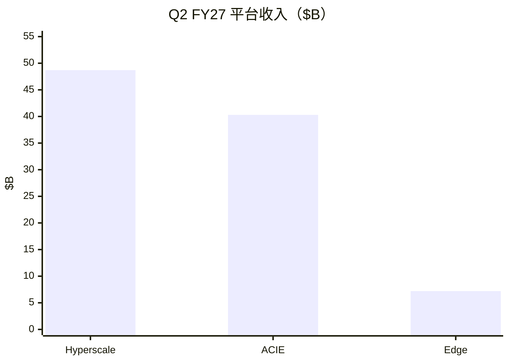

# 英伟达（NVDA）投研总览

> 上市地 **US**。财务 **Q2 FY2027（2026-07-26）**；行情 **2026-10-21**；催化 **2026-10-22**。  
> 框架 **growth-tech-research**；估值路由 **A**。不构成投资建议。

## 一句话判断

AI 算力平台龙头，单季 Data Center ~$890 亿、毛利率 ~75%；市值 **~$5.4T**、前瞻 PE ~**18**，相对中性增速并不离谱，但押注 AI 开支长周期，怕客户自研与利率冲击。

## 关键指标

| 指标 | 值 |
|------|-----|
| 股价 / 市值 | $221.97 / **$5.36T** |
| TTM / 前瞻 PE | 28.1 / **18.4** |
| PEG / PS TTM | **0.37** / 17.7 |
| Q2 收入 / DC | $96.2B / **$89.0B** |
| 毛利率 / 经营利润 | 75% / $63.7B |
| FCF TTM | **$127B** |
| Q3 指引 | **$108B ±2%** |
| 卖方目标价 | $329 |

## 关键图

## 单独报告

→ [英伟达-投研报告.md](英伟达-投研报告.md)

## 各章浓缩

| 章 | 一句结论 | 关键数 |
|----|----------|--------|
| [01](01-投资摘要.md) | 成长 A 轨匹配 | 市值 $5.36T |
| [02](02-生意模式与财务画像.md) | DC 绝对主导 | DC 占比 ~92% |
| [03](03-近1-2年重大变化.md) | 全栈 AI Factory | Rubin 量产 |
| [04](04-行业空间与竞争格局.md) | 空间有桥；自研是对手 | 买方集中 |
| [05](05-护城河与能力壁垒.md) | CUDA 宽 | GM 75% |
| [06](06-管理层·研发组织·资本配置.md) | 回报厚、承诺也厚 | 供应承诺 $279B |
| [07](07-成长路径与产品空间.md) | 中性 CAGR 25–40% | 低于卖方 |
| [08](08-现阶段估值.md) | Fwd PE ~18；PEG 亚 1 | 路由 A |
| [09](09-市场看法如何演变.md) | 卖方一致偏多 | 目标价 $329 |
| [10](10-近期大涨大跌归因.md) | 近端主因宏观 | 10 月 CPI |
| [11](11-综合判断与跟踪清单.md) | 盯指引与自研 | 11-18 财报 |

## 目录

- [01](01-投资摘要.md) … [11](11-综合判断与跟踪清单.md)
- [英伟达-投研报告](英伟达-投研报告.md)
- [data/](data/)
