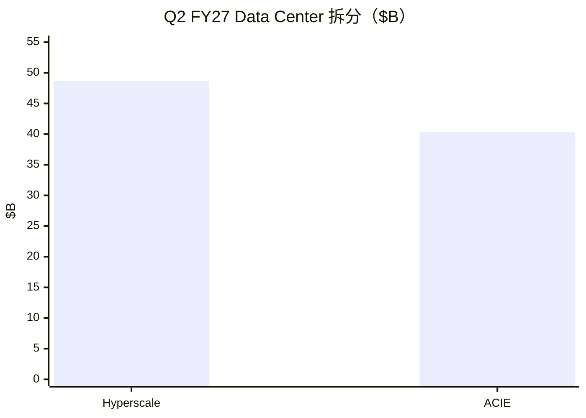
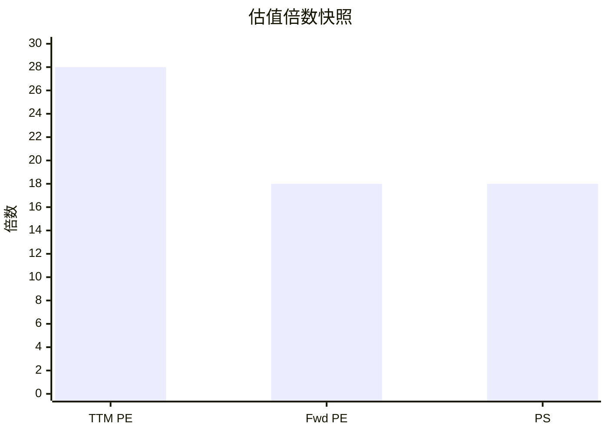
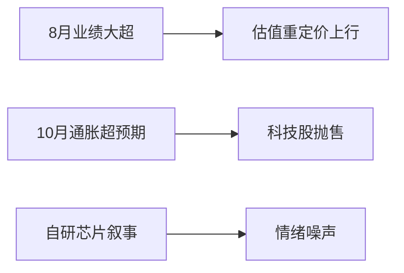

# 英伟达（NVDA）投研报告

> US｜growth-tech｜估值路由 **A**｜财务 Q2 FY2027｜行情 2026-10-21  
> **不构成投资建议。**

## 结论

英伟达把 AI 训练/推理基础设施做成了高利润率现金机器：Q2 FY27 收入 **$96.2B**（+106% YoY），Data Center **$89.0B**，毛利率 **75%**，经营利润 **$63.7B**。市值 **~$5.36T**、前瞻 PE ~**18**、PEG（中性）亚 1，相对增长并不像「纯泡沫倍数」；真正博弈是 **AI 资本开支能否多年维持高速**，以及超大规模客户自研芯片与巨型供应/担保承诺的尾部风险。

## 1. 摘要

| 项 | 内容 |
|----|------|
| 框架 / 路由 | growth-tech / **A**（PE≤50） |
| 下一催化 | 约 **2026-11-18** 财报 |

## 2. 财务画像

| | Q2 FY27 |
|--|---------|
| 收入 | $96.2B |
| Compute & Networking / Graphics | $88.3B / $7.9B |
| 毛利率 | 75% |
| GAAP / Non-GAAP EPS | $2.46 / $2.22 |
| Q3 指引 | **$108B ±2%**（不计中国 DC compute） |

TTM：收入 ~$303B，净利 ~$193B，FCF ~$127B，ROE ~117%。注意 GAAP 含大额股权投资收益。

## 3–4. 变化与竞争

结构：Blackwell/Rubin 代际 + 网络全栈 + 融资/电力生态；中国收入已边缘化。竞争：AMD 追赶；更大威胁是云厂商自研 ASIC。

## 5–6. 护城河与资本

CUDA/全栈护城河宽，利润率已证明。Q2 股东返还 ~$26B；供应承诺 **$279B**；担保敞口上限约 **$108.5B**——上行绑定更深，尾部风险更大。

## 7. 成长

| 情景 | 收入 CAGR |
|------|-----------|
| 中性 | **25–40%** |
| 卖方约 | ~61% |

## 8. 估值（A）

| 尺子 | 值 |
|------|-----|
| TTM / 前瞻 PE | 28 / **18** |
| PEG（FwdPE÷中性30%） | ~0.6 |
| PS TTM | 17.7 |
| 卖方目标价 | $329 |

## 9–10. 看法与涨跌

近端下跌主因宏观利率，非基本面塌方；中国份额新闻对收入影响已有限。

## 11. 跟踪

季度 vs $108B 指引、ACIE 扩散、毛利率、自研分流、承诺/担保披露。免责：研究练习非投资建议。

分册：[00-总览](00-总览.md)
