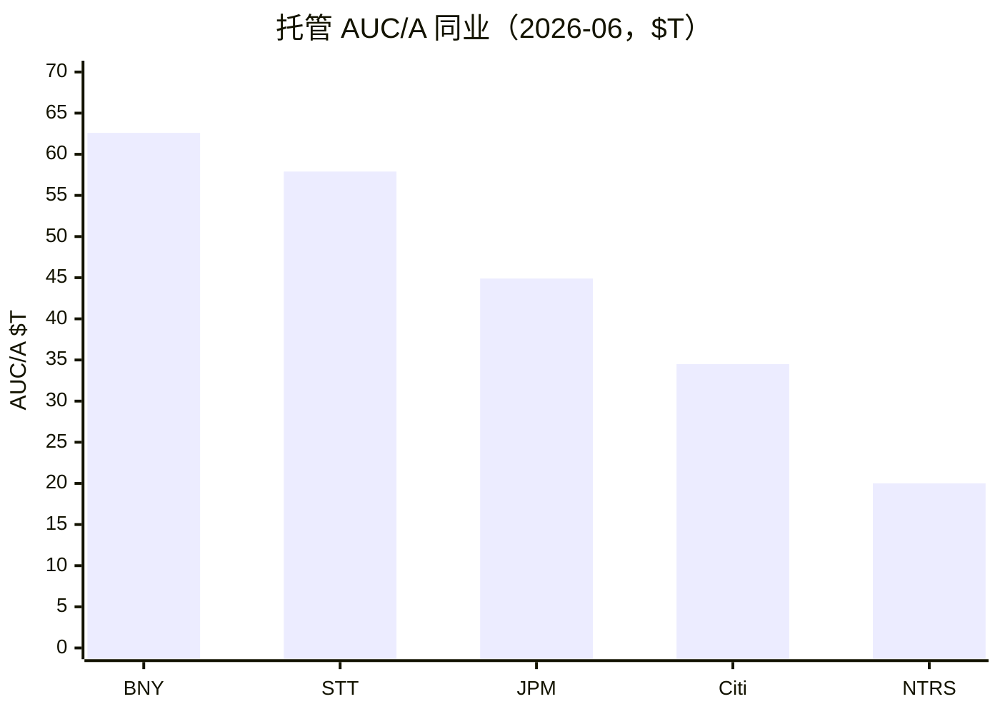

# 道富（STT）投研总览

> 上市地 **US**。财务时点 FY2025 + **3Q26**；行情 **2026-10-21**；催化 **2026-10-22**。  
> 框架 **value-leader-research**。不构成投资建议。

## 一句话判断

全球托管前二 + 万亿美元级资管，效率与 ROTCE 已改善；**前瞻 PE ~11、股东收益 ~5.6%**，近端跌因是费用指引/收入预期差，不是份额崩塌。

## 关键指标

| 指标 | 值 |
|------|-----|
| 股价 / 市值 | $168.95 / $46.1B |
| TTM / 前瞻 PE | 13.8 / **11.3** |
| PB / PB-ROE | 1.87 / **5.6**（五年均 ROE 10.5%） |
| 股息率 / 股东收益 | 2.2% / **~5.6%** |
| AUC/A / AUM | **$59.2T** / **$6.3T** |
| 3Q26 EPS / 税前利润率 | $3.69 / 34.6% |
| FY25 收入 / EPS | $13.9B / $9.40（ex $10.30） |

## 关键图

读法：STT 紧随 BNY；3Q26 STT 已升至 $59.2T。

## 单独报告

→ [道富-投研报告.md](道富-投研报告.md)

## 各章浓缩

| 章 | 一句结论 | 关键数 |
|----|----------|--------|
| [01](01-投资摘要.md) | 价值龙头框架匹配 | 市值 $46B |
| [02](02-基本面.md) | 费用条线清晰；杠杆改善 | Fee $11.0B（FY25） |
| [03](03-近1-2年重大变化.md) | 结构：提效+返还 | ROTCE 升 |
| [04](04-竞争格局与护城河.md) | 托管宽偏中；费率变薄 | 全球前二 |
| [05](05-成长性预测.md) | 中性收入 6–9% | 不外推 13% |
| [06](06-现阶段估值.md) | 前瞻 PE ~11 合理中性 | PB-ROE 5.6 |
| [07](07-市场看法如何演变.md) | 效率叙事遇费用预期差 | 目标价 $193 |
| [08](08-近期大涨大跌归因.md) | 10-14 可指名回撤 | −4%~−7% |
| [09](09-综合判断与跟踪清单.md) | 跟踪费率与净流入质量 | 表齐全 |

## 目录

- [01-投资摘要](01-投资摘要.md)
- [02-基本面](02-基本面.md)
- [03-近1-2年重大变化](03-近1-2年重大变化.md)
- [04-竞争格局与护城河](04-竞争格局与护城河.md)
- [05-成长性预测](05-成长性预测.md)
- [06-现阶段估值](06-现阶段估值.md)
- [07-市场看法如何演变](07-市场看法如何演变.md)
- [08-近期大涨大跌归因](08-近期大涨大跌归因.md)
- [09-综合判断与跟踪清单](09-综合判断与跟踪清单.md)
- [道富-投研报告](道富-投研报告.md)
- [data/](data/)

原始数据：`data/research_raw.json`
