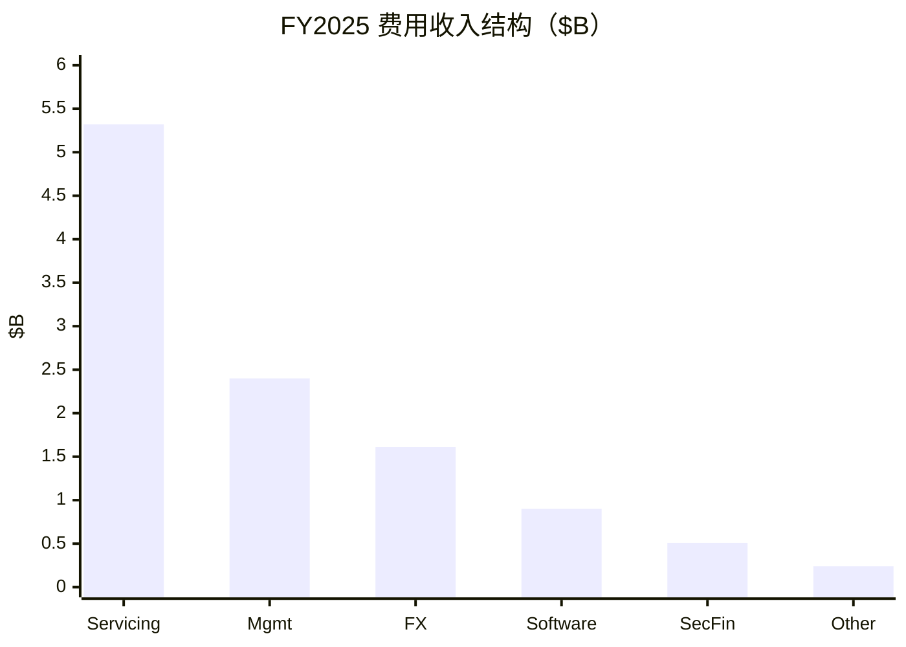
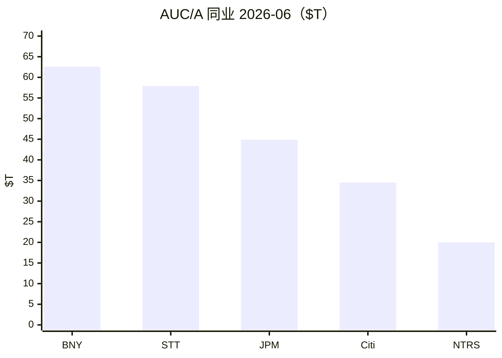
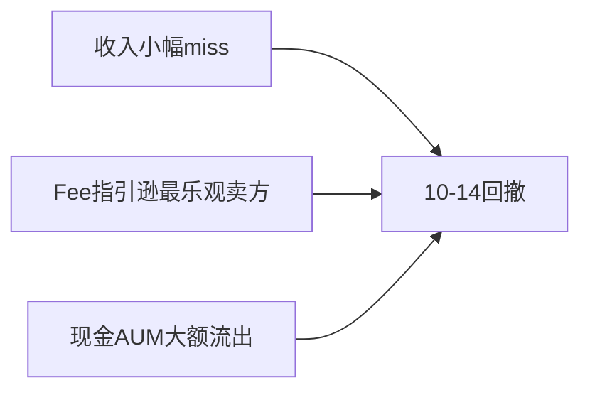

# 道富（STT）投研报告

> 上市地 US｜框架 value-leader-research｜财务 FY2025 + 3Q26｜行情 2026-10-21｜催化 2026-10-22  
> **不构成投资建议。** GAAP / ex-notables 分列。

## 结论

State Street 是全球托管与机构资服龙头之一（AUC/A **$59.2T**，紧随 BNY），兼有 **$6.3T** 资管。近两年主线是**经营杠杆与资本返还**抬升 ROTCE；现价 **$168.95 / $46B 市值**，前瞻 PE **~11**、PB **~1.9**、股东收益 **~5.6%**，匹配中速复利金融股。**2026-10-14** 因收入略逊、fee 指引不及最乐观卖方及现金大额流出回撤数个点——属预期差，非护城河崩塌。

## 1. 摘要

| 项 | 内容 |
|----|------|
| 框架 | value-leader（非成长放量、非平台 SOTP 主问题） |
| 生意 | 托管费 + 管理费 + FX/证金/软件 + NII |
| 估值锚 | 前瞻 PE、PB-ROE、股东回报 |

## 2. 基本面

| 指标 | FY25 | 3Q26 |
|------|------|------|
| 总收入 | $13.94B（+7%） | $4.00B（+13%） |
| Fee / NII | $10.98B / $2.96B | $3.14B / $0.86B |
| EPS | GAAP $9.40；ex $10.30 | $3.69（+33%） |
| 税前利润率 | 26.8%（ex 29.2%） | **34.6%** |
| ROE / ROTCE | 11.5% / 17.9% | 16.4% / **25.1%** |
| AUC/A / AUM | $53.8T / $5.67T | **$59.2T / $6.31T** |

Servicing 约占费用收入一半；管理费约两成。隐患：费率头风、市场贝塔、other fee 市值噪音。

## 3. 近 1–2 年变化

2023 盈利低谷 → 2024–25 效率与牛市共振 → 2026 利润率上台阶并追赶 BNY 规模差距。结构项是提效与回购；周期项是市值贝塔与 NII。

## 4. 竞争与护城河

护城河：**宽偏中**（切换成本高，但买方议价强）。变薄路径优先看定价与大客户转托，其次资管流入质量。

## 5. 成长性

| 情景 | 收入 CAGR | EPS CAGR |
|------|-----------|----------|
| 中性 | **6–9%** | **10–14%** |
| 公司 FY26 指引 | Fee +13–14%；NII +15–16% | （单年，不外推） |

卖方 3Y EPS ~20% 偏乐观于本中性。

## 6. 估值

| 尺子 | 值 |
|------|-----|
| TTM / 前瞻 PE | 13.8 / **11.3** |
| PB | 1.87 |
| 五年均 ROE / PB-ROE | 10.5% / **5.6** |
| 股息率 / 股东收益 | 2.2% / **~5.6%** |
| 卖方目标价 | $193（对照用） |

银行弱化负 EV。结论：合理中性，弹性在盈利能否跟上。

## 7. 市场看法

叙事：重组阴霾 → 效率修复 → 杠杆定价 → **10 月费用预期差**。卖方仍 Buy。

## 8. 涨跌归因

主因：收入/指引预期差 + 流入结构；非托管份额崩塌证据。

## 9. 跟踪与免责

盯：servicing 新单、管理费净流入质量、税前利润率、CET1 与回购、相对 BNY 的 AUC/A。  
免责：研究练习，非投资建议；以最新 SEC/IR 为准。

分册：[00-总览](00-总览.md)
