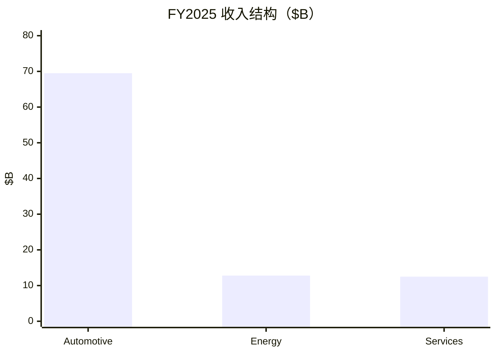

# 特斯拉（TSLA）投研总览

> 上市地 **US**。财务 FY2025 + **3Q26**；行情/催化 **2026-10-21**。  
> 框架 **growth-tech-research**；估值路由 **B**（PE≪主尺子；PS + 路径回推）。不构成投资建议。

## 一句话判断

汽车主业增速失速、储能与 FSD 接力，市值 **~$1.5T / PS ~15×** 主要交易 Robotaxi/Optimus 期权；3Q26 FCF 惊喜与 **capex 指引下调**使盘后叙事分裂。

## 关键指标

| 指标 | 值 |
|------|-----|
| 股价（收/盘后约） | $386.47 / ~$374 |
| 市值 | **$1.53T** |
| TTM 收入 / 净利 | $103.6B / $3.22B |
| TTM PE / 前瞻 PE | **425 / 185** |
| PS TTM | **14.8** |
| FY25 汽车/能源/服务 | 73% / 13% / 13% |
| 3Q26 毛利率 / FCF | 19.6% / **$1.5B** |
| FSD 活跃订阅 | 174 万 |

## 关键图

## 单独报告

→ [特斯拉-投研报告.md](特斯拉-投研报告.md)

## 各章浓缩

| 章 | 一句结论 | 关键数 |
|----|----------|--------|
| [01](01-投资摘要.md) | 成长框架 + B 轨 | 市值 $1.53T |
| [02](02-生意模式与财务画像.md) | 车承压、能服增 | 经营利润率 4.6% |
| [03](03-近1-2年重大变化.md) | 叙事切到物理 AI | Robotaxi 启动 |
| [04](04-行业空间与竞争格局.md) | 空间要有桥 | BEV 竞争高 |
| [05](05-护城河与能力壁垒.md) | 数据护城河未兑现 | 订阅 174 万 |
| [06](06-管理层·研发组织·资本配置.md) | Capex 下调惹争议 | 指引 $20B |
| [07](07-成长路径与产品空间.md) | 中性收入 8–14% | 期权不并表 |
| [08](08-现阶段估值.md) | B 轨 PS 偏贵 | PS 14.8× |
| [09](09-市场看法如何演变.md) | AI 溢价拥挤 | 目标价 ~$398 |
| [10](10-近期大涨大跌归因.md) | 10-21 可指名 | FCF vs Capex |
| [11](11-综合判断与跟踪清单.md) | 期权定价敏感 | 跟踪表 |

## 目录

- [01](01-投资摘要.md) … [11](11-综合判断与跟踪清单.md)
- [特斯拉-投研报告](特斯拉-投研报告.md)
- [data/](data/)
