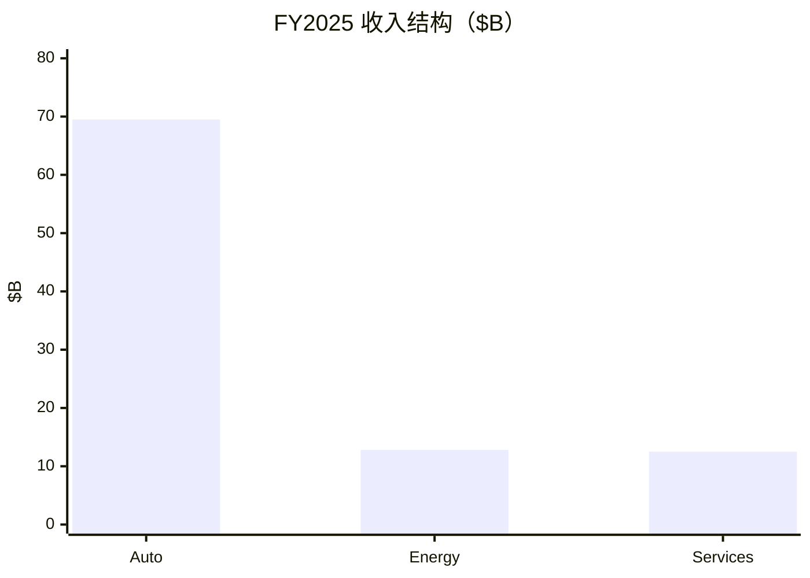
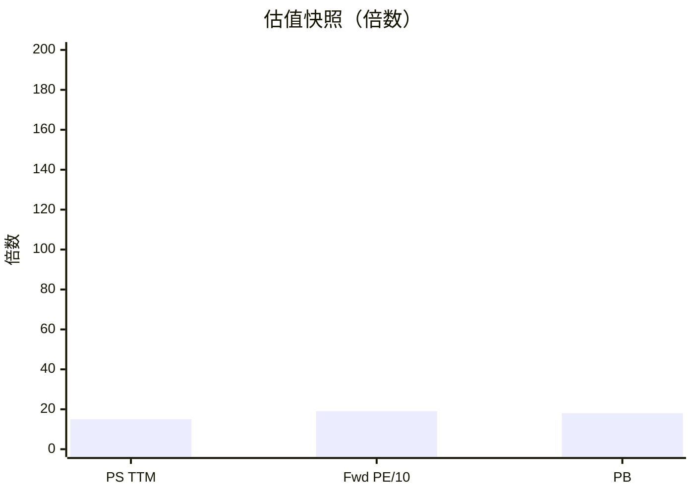
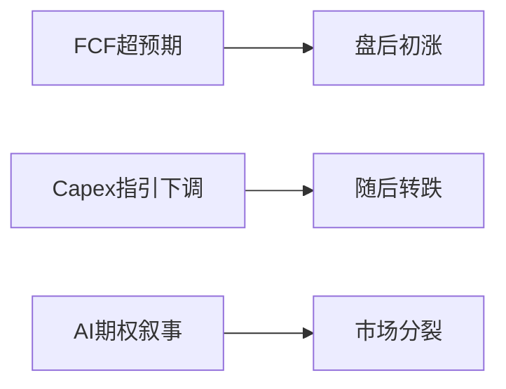

# 特斯拉（TSLA）投研报告

> US｜growth-tech-research｜估值路由 **B**｜财务 FY2025+3Q26｜行情/催化 2026-10-21  
> **不构成投资建议。**

## 结论

特斯拉正从「高增整车」转向「物理 AI」叙事：FY25 汽车收入 **−10%**，能源 **+27%**，服务 **+19%**；GAAP 利润率下到个位数。市值 **~$1.53T**、PS **~15×**、前瞻 PE **~185**，常规整车盈利撑不住——溢价在 **FSD/Robotaxi/Optimus**。3Q26 毛利率 19.6%、FCF **$1.5B** 超预期，但全年 capex **$25B→$20B** 引发「是否 All-in AI」质疑，盘后回吐。

## 1. 摘要

| 项 | 内容 |
|----|------|
| 框架 / 路由 | growth-tech / **B** |
| 核心矛盾 | 近端造血 vs 远端期权投入 |

## 2. 财务画像

| | FY25 | 3Q26 |
|--|------|------|
| 收入 | $94.8B（−3%） | $28.0B |
| 毛利率 | 18.0% | **19.6%** |
| 经营利润 | $4.4B（利润率 4.6%） | $0.72B |
| EPS GAAP / Non-GAAP | $1.08 / $1.66 | Adj $0.48 |
| FCF | $6.2B | **$1.5B** |
| 现金及投资 | $44.1B | ~$45B+ |

## 3–4. 变化与竞争

结构：Robotaxi（Austin）、Optimus 试产、储能放量。周期：价格战与交付波动。BEV 竞争烈；智驾对手含 Waymo 等。

## 5–6. 护城河与资本

数据闭环护城河**未完全兑现**。FSD 活跃订阅 **174 万**。Capex 指引下调改善 FCF，但与 AI 里程碑存在张力；SpaceX 合并讨论「非必然」。

## 7. 成长情景

| 情景 | 收入 CAGR |
|------|-----------|
| 中性 | **8–14%** |
| 卖方约 | ~15% |

Robotaxi/Optimus 作期权，不塞进近 3 年中性主表。

## 8. 估值（B 轨）

（Fwd PE 除以 10 仅便于同图量级；真实前瞻 PE ~185。）

路径回推：需「远期高净利率 + 收入大幅上台阶」或持续故事市才能消化 $1.5T。

## 9–10. 看法与涨跌

主因：开支节奏 vs AI 叙事；非单一交付爆雷。

## 11. 跟踪

交付与汽车毛利、FSD/Robotaxi 单位经济、储能订单、capex 与算力节点、SpaceX 交易条款。

免责：研究练习非投资建议；FSD 为 Supervised。

分册见 [00-总览](00-总览.md)。
