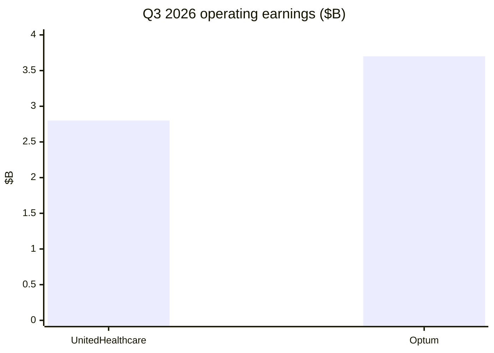

# UnitedHealth Group (UNH) Research Overview

> Market **US**. Financials through **Q3 2026**; price **2026-10-21**; catalysts **2026-10-22**.  
> Framework **value-leader-research**. Not investment advice.

## One-line judgment

Margins are healing while membership shrinks; at **~$417 / $374B**, forward PE ~**18** and FCF yield ~**6%** price a **repair story**—still hostage to MA Stars, medical trend, and DOJ overhang.

## Key metrics

| Metric | Value |
|--------|-------|
| Price / mcap / EV | $417 / **$374B** / $423B |
| TTM / forward PE | 23.8 / **18.4** |
| PB / ROE | 3.61 / 15.8% |
| FCF yield / shareholder yield | **6.1%** / ~3.2% |
| Q3 rev / op. earnings | $112.7B / **$6.6B** |
| Q3 adj EPS / FY26 adj guide | $4.69 / **≥$20.50** |
| MCR (Q3) | **88.4%** |
| UHC members | **48.3M** (MA −935k YTD) |
| Street target | $477 |

## Chart

## Standalone report

→ [UnitedHealth-Research-Report.md](UnitedHealth-Research-Report.md)

## Chapter digest

| Ch | One-line | Key figure |
|----|----------|------------|
| [01](01-Investment-Summary.md) | Value-leader fit; repair vs legal | Mcap $374B |
| [02](02-Fundamentals.md) | Shrink-to-profit; Optum mix | OI $6.6B |
| [03](03-Recent-Structural-Changes.md) | Structural prune + governance | MA −935k |
| [04](04-Competition-and-Moat.md) | Wide scale; trust tested | Moat medium-wide |
| [05](05-Growth-Outlook.md) | Rev 0–4%; EPS via margins | Guide ≥$20.50 |
| [06](06-Valuation.md) | Fwd ~18×; FCF ~6% | PB–ROE ~4.4 |
| [07](07-Market-Narrative.md) | Crisis → repair → show-me | Target $477 |
| [08](08-Recent-Price-Moves.md) | Beat vs membership/legal | Q3 10-13 |
| [09](09-Judgment-and-Tracking.md) | Reasonable repair multiple | Tracking table |

## Directory

- [01-Investment-Summary](01-Investment-Summary.md)
- [02-Fundamentals](02-Fundamentals.md)
- [03-Recent-Structural-Changes](03-Recent-Structural-Changes.md)
- [04-Competition-and-Moat](04-Competition-and-Moat.md)
- [05-Growth-Outlook](05-Growth-Outlook.md)
- [06-Valuation](06-Valuation.md)
- [07-Market-Narrative](07-Market-Narrative.md)
- [08-Recent-Price-Moves](08-Recent-Price-Moves.md)
- [09-Judgment-and-Tracking](09-Judgment-and-Tracking.md)
- [UnitedHealth-Research-Report](UnitedHealth-Research-Report.md)
- [data/](data/)
