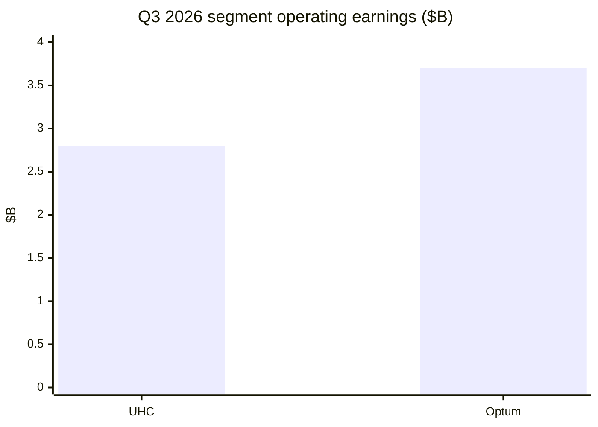
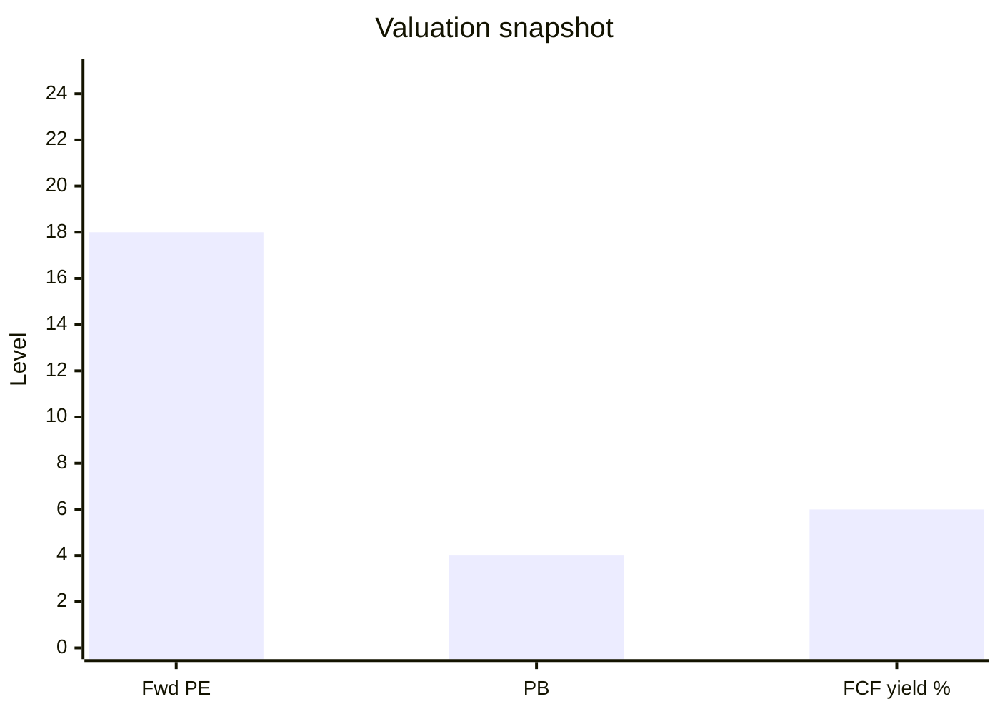

# UnitedHealth Group (UNH) Research Report

> US | **value-leader-research**  
> Financials through **Q3 2026** | Price **2026-10-21** | Catalysts **2026-10-22**  
> **Not investment advice.**

## Conclusion

UnitedHealth is executing a classic **insurer repair**: raise prices, redesign benefits, cut unprofitable membership (MA **−935k** YTD), and stabilize Optum. Q3 revenue was **$112.7B** (−0.4% YoY), operating earnings **$6.6B**, adjusted EPS **$4.69** (beat), MCR **88.4%**. FY26 adjusted EPS guide raised to **≥$20.50**. At **$417 / $374B** market cap, forward PE ~**18** and FCF yield ~**6%** look **reasonable for a recovering franchise**—not deep distress pricing, and **not** a clean bill of health while Stars, elevated medical trend, and DOJ/state probes linger.

## 1. Summary

| Item | Content |
|------|---------|
| Framework | value-leader (not growth-tech / not pure platform SOTP) |
| Thesis | Margin repair > volume; cash returns intact |
| Key risk | MA quality economics + legal overhang |

## 2. Fundamentals

| | Q3 2026 |
|--|---------|
| UnitedHealthcare | Rev $86.3B; OI $2.8B; OM 3.3%; 48.3M members |
| Optum | Rev $66.9B; OI $3.7B |
| Optum Health | Rev $22.9B (−10%); OI $735M |
| Optum Insight | Rev $5.5B (+3%); OI $1.3B |
| Optum Rx | Rev $39.9B; OI $1.7B |
| Consolidated | Rev $112.7B; OI $6.6B; CFO $5.1B |

TTM: revenue ~$450B, NI ~$15.9B, FCF ~$22.8B. Debt-to-capital **41.7%** (target ~40%). YTD buybacks **$5B** + dividends **$6.2B**.

## 3–4. Change and moat

**Structure:** prune lives, reprice, Optum Health exits weak VBC markets, governance refresh after 2025 trust crisis.  
**Moat:** scale + vertical integration still **wide**, but buyer power (CMS/employers) and legal/political pressure are actively testing trust. NSA/IDR still adds medical cost headwind (~100bps+ per CFO commentary).

## 5. Growth

| | Base case |
|--|-----------|
| Revenue CAGR ~3Y | **0–4%** (aligned with Street ~3%) |
| EPS | **Margin-led** 10–18% (Street ~18% at optimistic end) |
| Near term | Co. adj EPS **≥$20.50** for FY26 |

Do not treat favorable reserve development as permanent.

## 6. Valuation

| Metric | Value |
|--------|-------|
| Fwd PE | **~18.4×** |
| PB / ROE | 3.61× / 15.8% |
| PB–ROE (current) | ~**4.4** |
| FCF yield | **6.1%** |
| Street target | $477 |

**Read:** Cash-generative repair multiple; re-rating to historical premiums needs Stars + legal clarity.

## 7–8. Narrative and price action

Crisis (2025) → repair (2026 beats/raises) → show-me on membership quality and regulation. Q3 day: earnings beat vs volume/legal noise. ~3-month stretches still saw double-digit pullbacks on idiosyncratic headlines.

## 9. Tracking

Watch MCR quality, MA membership/Stars, Optum Health patient counts, DOJ/AG docket, buyback continuity.  
Disclaimer: research exercise, not investment advice.

Chapters: [00-Overview](00-Overview.md)
